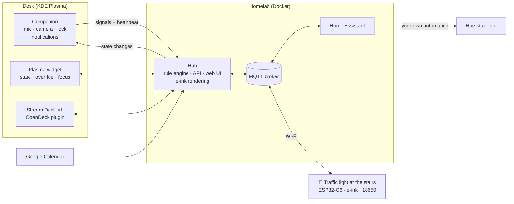
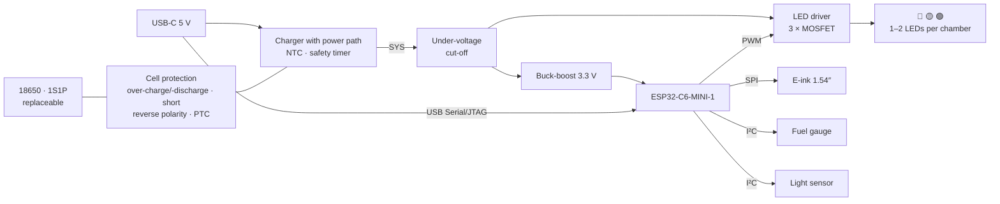

# office-traffic-light 🚦

**A traffic light for my basement office.** From the hallway the family can see whether it's worth coming downstairs:
🔴 **red** = meeting, please don't disturb · 🟡 **yellow** = working, come in if it's important · 🟢 **green** = come in · ⚫ **off** = not in the office.

The state is detected automatically (microphone/camera, Google Calendar, working hours, screen lock) and can be overridden at any time from a KDE widget, a Stream Deck or the web UI. Open source & open hardware: software, firmware, PCB (KiCad) and a 3D-printed enclosure (OpenSCAD).

> **Status: early development.** This README is the project definition and feature set (as of 2026-10-29). The repo is public from day one so anyone can follow the project as it grows. The hub core (M0) is in [`hub/`](hub/).
>
> More documents: [Breadboard prototype & parts list](docs/breadboard.md) · [Development setup](docs/dev-setup.md) · [Hub](hub/README.md) · [API (OpenAPI)](api/openapi.yaml)

## Signals

One traffic light, three chambers, just like on the road: red on top, yellow in the middle, green at the bottom. The position tells the meaning, even without telling the colours apart.

| Light | State | Meaning | E-ink sign (example) |
|---|---|---|---|
| 🔴 red | `dnd` | Meeting – please don't come in | "Meeting · until 14:30" |
| 🟡 yellow | `working` | Working – only if it's important | "Working · next meeting 15:00" |
| 🟢 green | `free` | Come in! | "Free · next appointment tomorrow 09:00" |
| ⚫ off | `away` | Not in the office (PC locked or off) | "Not in the office" |

**Phases**, modelled on the Austrian road traffic regulations (StVO § 38):

| Light | Phase | When |
|---|---|---|
| 🟢 blinking | **Last call** | N minutes (default 5) before a meeting – "quick, I'm in a meeting soon" |
| 🔴 + 🟡 | **Ending soon** | the last N minutes of a meeting. In the StVO, red+yellow means: stop, green is coming |
| 🟡 blinking | **Fault** | hub or Wi-Fi gone, data too old. Blinking yellow means "caution" in the StVO |
| off + "battery empty" | **Battery empty** | cut-off threshold reached |

Transitions work like on a real traffic light: yellow shows briefly (≈ 3 s) before red.

### E-ink sign

A small e-ink display sits below the light. It shows **absolute times instead of a countdown** ("until 14:30" rather than "23 min left"). So the content only changes when the state changes: no motion sensor needed, no power while idle.

```
┌────────────────────┐
│ MEETING            │
│ until 14:30        │  ← large font
│ camera on          │
│ then work → 17:00  │
│ ▮▮▮▯ 72 %    14:02 │
└────────────────────┘
```

1.54″, 200 × 200 pixels. The light already shows the colour; the sign adds the small print. "until 14:30" is ~5 mm tall, the rest ~2 mm: readable when you stand at the top of the stairs.

Content: reason, until when, what comes next, hints such as "camera on" (don't walk through the picture), battery level and a "last updated" time. That time is refreshed every 15 min with a partial refresh so a frozen display stands out. Event titles are never shown.

## Feature set

### Must – v1

- **Traffic light hardware:** three chambers (red/yellow/green), ESP32-C6, Wi-Fi + MQTT, 18650 cell with safe charging electronics, USB-C for charging *and* permanent power
- **E-ink sign:** until when, what's next, reason, battery
- **Enclosure as a miniature traffic light** (OpenSCAD) with a removable wall mount
- **Automatic detection:**
  - microphone or camera in use → red
  - Google Calendar → red or yellow, by rules
  - working hours (incl. Austrian public holidays) → yellow
  - PC locked → off
  - otherwise → green
- **Manual override with duration:** from 15 min to "until end of work day" or indefinite; "auto" resets
- **KDE Plasma widget** (panel and desktop): see the detected state and its reason, override with a time, focus/pomodoro
- **Desktop notification** on every state change
- **Last call** and **failsafe** (see Signals)
- **Home Assistant via MQTT discovery:** state, state-change event, current slot, next free slot, battery
- **Hub as a Docker container** in the homelab

### Should

- **Ending soon** phase (red+yellow)
- **Stream Deck XL** as a control panel
- **Flashing and Wi-Fi setup in the browser** (ESP Web Tools + Improv), OTA updates
- **Automatic brightness** via light sensor, night dimming
- **Battery runtime estimate** in HA

### Could

- Generic **webhook signals**, e.g. for Claude Code (see below)
- **ESPHome example config** for builds on mains power ("bring your own lamp")
- **Prometheus metrics** and a Grafana dashboard (meeting statistics)
- **Wi-Fi 6 TWT** on the ESP32-C6 for longer battery life, if the router supports it
- Companion for Windows/macOS, GNOME extension
- Several people or traffic lights
- "Tell me when free" push (ntfy) – for families who don't just text anyway

### Won't – on purpose

| Idea | Why not |
|---|---|
| A second light at the basement door | The decision is made at the top of the stairs – one light is enough |
| Knock button / back channel | The family texts on WhatsApp anyway |
| Dedicated control desk ("signal box") | Stream Deck XL + widget cover it |
| Motion / mmWave sensor on the device | The LEDs stay on (visible from the hallway) and the e-ink only changes with the state. An mmWave sensor (~70–80 mA) would drain the battery in 1–2 days |
| ESP-NOW / Thread / Zigbee | Wi-Fi is good everywhere, MQTT broker and HA exist – Wi-Fi is simpler |
| Countdown on LEDs | too much power – the e-ink shows absolute times |
| Work/private detection via folder paths, VPN etc. | doesn't fit: everything runs on one machine, paths are personal |
| Ready-made HA automations | entities + triggers only; everyone builds their own automations |
| RGB LEDs (WS2812) | real single colours, position encodes meaning; WS2812 draw current even when "off" |

## Architecture



**Principle: smart hub, dumb light.** The hub decides everything – state, phase, blink pattern, e-ink content – and publishes it via MQTT. The light only displays, reports telemetry and switches to "fault" by itself when the hub goes quiet.

| Component | Tech | Job |
|---|---|---|
| Hub | Go, Docker, SQLite | Rule engine, calendar, working hours, REST/SSE API, web UI, MQTT + HA discovery, e-ink rendering |
| Companion | Go, systemd user service | Microphone/camera (PipeWire), screen lock, desktop notifications, OAuth helper |
| Plasma widget | QML (Plasma 6) | State, override, focus/pomodoro |
| Stream Deck plugin | TypeScript (Elgato SDK) | Control panel on the Stream Deck XL |
| Firmware | C, ESP-IDF | Wi-Fi power saving, MQTT, LEDs, e-ink, battery |
| Project homepage | GitHub Pages (static) + own domain | Required for Google's OAuth branding (description, privacy policy, terms), plus docs, web flasher (ESP Web Tools needs HTTPS) and the OAuth redirect relay. No backend, no user data |
| PCB | KiCad | ESP32-C6, charging, LED and e-ink drivers – assembled by JLCPCB |
| Enclosure | OpenSCAD + BOSL2 | Miniature traffic light + removable wall mount |

Home Assistant is not a separate component: the hub announces its entities via MQTT discovery and HA picks them up.

**Why Go?** One static binary per component, tiny Docker images, good libraries for MQTT, D-Bus and Google APIs – and the companion can later be cross-compiled for Windows/macOS.

**API first:** the OpenAPI spec in [`api/openapi.yaml`](api/openapi.yaml) is the contract between hub, companion, widget and Stream Deck plugin. A test keeps spec and router in sync.

| Endpoint | Purpose |
|---|---|
| `GET /api/v1/status` | current state incl. reason, slot, next free slot |
| `GET /api/v1/timeline?from=…&to=…` | planned slots from calendar, working hours and timers |
| `PUT` / `DELETE /api/v1/override` | set an override (status + duration or end) / clear it |
| `PUT` / `DELETE /api/v1/focus` | start / stop a focus (pomodoro) timer |
| `POST /api/v1/signals/companion` | companion heartbeat (microphone, camera, lock) |
| `POST` / `DELETE /api/v1/signals/{source}` | webhook signals with TTL |
| `GET /api/v1/events` | live updates (Server-Sent Events) |

## State logic

Every source contributes a *claim*: status, priority and validity. The best valid claim wins.

| Prio | Source | Result | Details |
|---|---|---|---|
| 1 | Manual override (widget, Stream Deck, web UI, focus timer) | any | always ends: after a duration, "until the event ends", "until end of work day" – or explicitly indefinite |
| 2 | Microphone or camera in use | `dnd` | counts after ≥ 10 s (debounce), holds for 2 min (reconnects, chat after the call) |
| 3 | PC locked or companion silent | `away` | only if microphone and camera are off |
| 4 | Calendar event | `dnd` / `working` / `away` | rules per event kind |
| 5 | Working hours | `working` | weekly plan, public holidays, extra days off |
| 6 | Webhook signals (optional) | usually `working` | with TTL |
| 7 | Default | `free` | – |

- **Microphone/camera beat the lock screen:** nobody locks the PC by hand during a call. But in a meeting where you only listen, you don't touch the mouse, and after a few minutes the screen locks itself. It stays red anyway.
- **Conflict hint:** if a manual override (e.g. green) is running and the microphone goes on, the notification asks "switch to red?"
- **Heartbeats:** the companion reports every 30 s. If it is silent for 90 s (PC off, standby), that counts as "locked".
- **Failsafe on the light:** hub offline (MQTT Last Will) or state too old → yellow blinks.
- **Planning ahead:** the hub knows the future (calendar + working hours). From it, it computes the current slot, the next change and the next free slot – for the e-ink, the widget and HA.
- **Unknown end:** a call without a calendar entry or a locked screen has no known end. Then `until` and `next_free` are `null` instead of a guess. If a calendar meeting is running during a call, the call is assumed to end with the meeting.

## Signal sources

### Companion (Linux)

- **Microphone:** PipeWire capture streams (`media.class = Stream/Input/Audio`) in state "running". Ignored:
  - level meters (pavucontrol, the Plasma volume applet)
  - recordings of outputs (monitor sources, e.g. screen recording)
  - apps on a configurable ignore list
- **Camera:** open `/dev/video*` devices and PipeWire video streams.
- **Screen lock:** logind `LockedHint` or `org.freedesktop.ScreenSaver`.
- **Notifications** on every state change, with the reason ("🔴 microphone in use – Firefox") and quick actions ("wrong detection", "clear override").
- **Reference setup:** CachyOS, KDE Plasma 6 (Wayland), PipeWire.

### Google Calendar

- **Connection:** Google Calendar API (recommended: near real time, provides `eventType`, attendees and conference links) or the secret iCal address (simpler, but sometimes heavily delayed).
- **Rules per event kind** (configurable), for example:
  - event with attendees or a video link → `dnd`
  - `focusTime` or titles like "Focus|Blocker" → `working`
  - `outOfOffice` or "vacation" → `away`
  - all-day events and events marked "free" → ignored
  - events the provider can't classify → `dnd` by default
- **Mirrored events:** in the reference setup an Apps Script copies work events into the private calendar, and attendees often get lost. Tip: let the script mark meetings (colour, prefix or `extendedProperties`) and the hub reads the mark.
- **M0 status:** the hub has a calendar interface with a fake implementation; the Google provider comes next.

#### Google sign-in for self-hosters

Two separate problems:

1. **Long-lived tokens.** While an OAuth app is in "Testing", refresh tokens expire after 7 days. To **publish** the app, the Google Auth Platform requires a complete branding page: homepage, privacy policy, terms of service and an authorized domain. The homepage must describe the app; a bare login page is not enough. For verification by Google you must also prove that you own the domain (Search Console). → **Without a real project homepage there is no long-term operation.**
2. **Redirect.** Every installation runs its hub under a different address, usually without public HTTPS. Web clients need an HTTPS redirect to a public domain. Desktop clients are the exception: they may redirect to loopback (`127.0.0.1`). Google does not allow the device flow ("enter a code on another device") for calendar scopes.

**Plan:**

- **Project homepage with its own domain** (GitHub Pages + custom domain, verified in Search Console): description, logo, screenshots, privacy policy, terms of service, docs and web flasher.
- **Stage 1 – for the reference build:** an own OAuth client whose branding points to the project homepage. It can then be published and the 7-day limit is gone. Until verification Google shows a warning at sign-in and caps unverified apps at 100 users.
- **Stage 2 – for everyone else:** a **shared project OAuth client**, verified by Google. `calendar.readonly` is a "sensitive" scope, not a "restricted" one: it needs a justification and a demo video, but no paid security assessment. After that, nobody needs their own Google Cloud console.
  - **Sign-in via the companion:** client type "desktop app", loopback redirect to `127.0.0.1`. Google explicitly does not treat the client secret of installed apps as a secret, so it may live in open-source code.
  - **Sign-in via the web UI without companion:** a **redirect relay** on the homepage, modelled on `my.home-assistant.io`. Google redirects to `https://<homepage>/oauth/callback`, and the static page forwards code and `state` to the hub address this browser stored locally before. The target never comes from URL parameters, otherwise the relay would be an open redirect. Still open: web clients need the client secret for every token refresh in the hub. To be checked before stage 2 starts.
- **Fallback without OAuth:** the calendar's secret iCal address – without `eventType` and attendees, and Google sometimes updates the feed with a long delay.

### Working hours

Weekly plan (e.g. Mon–Fri 08:00–17:00), public holidays per country (Austria built in), extra days off from the config, vacation and absence from the calendar.

### Webhooks (optional) – e.g. Claude Code

Any tool can set a claim with a TTL via `POST /api/v1/signals/<name>`. Example of a Claude Code hook in `~/.claude/settings.json`:

```json
{
  "hooks": {
    "UserPromptSubmit": [
      {
        "hooks": [
          {
            "type": "command",
            "command": "curl -fsS -m 2 -X POST \"$OTL_URL/api/v1/signals/claude\" -H \"Authorization: Bearer $OTL_TOKEN\" -d '{\"status\":\"working\",\"ttl\":\"30m\"}' || true"
          }
        ]
      }
    ]
  }
}
```

> Only a partly reliable work signal: sessions often stay open for days, run over SSH on servers, and long output gets read without a new prompt. Hence optional.

## Controls

### KDE Plasma widget

- **Panel:** a mini traffic light as icon (the active lamp lights up), tooltip with reason and "until".
- **Right-click menu:** "open web UI", "auto", quick overrides.
- **Popup:**
  - detected state with source ("microphone in use", "calendar: meeting until 14:30")
  - override: red / yellow / green / off for 15 min, 30 min, 1 h, 2 h, until the event ends, until end of work day, or indefinite
  - "auto" clears the override
  - focus/pomodoro, e.g. 25/5 or 50/10 (work phase yellow, break green – configurable)
  - day bar: today's slots as a coloured bar
- Works in the panel and on the desktop; distributed via the KDE Store ("Get New Widgets").
- **Other desktops:** the web UI can be installed as a PWA; a GNOME extension would be a nice community project.

### Stream Deck XL

A plugin based on the official Elgato SDK. On Linux it runs in [OpenDeck](https://github.com/nekename/OpenDeck), which supports Elgato SDK plugins; on Windows/macOS in the Elgato app. Alternative: a plugin for [StreamController](https://github.com/StreamController/StreamController).

Proposed layout (8 × 4) – **the left column is the traffic light:**

| | 1 | 2 | 3 | 4 | 5 | 6 | 7 | 8 |
|---|---|---|---|---|---|---|---|---|
| **A** | 🔴 red | state | until 14:30 | next free | 15 min | 30 min | 1 h | ∞ |
| **B** | 🟡 yellow | reason | 🎙 mic | 📷 camera | focus 25 | focus 50 | break 5 | ⏱ 12:34 |
| **C** | 🟢 green | 🔋 72 % | | | | | | |
| **D** | auto | | | | | | | |

- The lamp keys show live which lamp is on. Pressing one sets an override (duration via a duration key or long press).
- Free keys stay available for other things.

### Web UI

State and override, day view, rules, calendar connection, working hours, device health (battery, Wi-Fi, firmware), history.

## Home Assistant & MQTT

The hub only creates entities via MQTT discovery (one device, device-based discovery) – everyone builds their own automations.

| Entity | Type | Content |
|---|---|---|
| `sensor.office_traffic_light_status` | enum | `free`, `working`, `dnd`, `away` – attributes: reason, detail, phase, light, since, until |
| `event.office_traffic_light_status_changed` | event | every state change (from → to, reason) – the trigger for your own automations |
| `sensor.office_traffic_light_slot_start` / `…_slot_end` | timestamp | current slot |
| `sensor.office_traffic_light_next_free_start` / `…_next_free_end` | timestamp | next free slot |
| `sensor.office_traffic_light_battery` | % | battery level, plus voltage and runtime estimate (announced by the light itself) |
| `binary_sensor.office_traffic_light_charging` | binary | charging / on USB (announced by the light itself) |
| diagnostics | – | Wi-Fi signal, firmware version, online |

| Topic | Content |
|---|---|
| `office-traffic-light/state` | retained JSON (see below), same document as `GET /api/v1/status` |
| `office-traffic-light/event` | `status_changed` events for the HA event entity (not retained) |
| `office-traffic-light/hub/online` | `online` / `offline`, retained; `offline` is the hub's Last Will → failsafe on the light |
| `office-traffic-light/display` | retained bitmap for the e-ink, rendered by the hub (reserved, comes with the firmware) |
| `office-traffic-light/device/<id>/telemetry` | battery, charging, RSSI, firmware |
| `office-traffic-light/device/<id>/cmd` | OTA, restart, identify |

```json
{
  "status": "dnd",
  "phase": "ending_soon",
  "light": "red_yellow",
  "reason": "calendar",
  "detail": "meeting",
  "since": "2026-10-28T14:00:00+01:00",
  "until": "2026-10-28T14:30:00+01:00",
  "next": { "status": "working", "reason": "work_hours", "since": "2026-10-28T14:30:00+01:00", "until": "2026-10-28T17:00:00+01:00" },
  "next_free": { "start": "2026-10-28T17:00:00+01:00", "end": "2026-10-29T08:00:00+01:00" },
  "updated": "2026-10-28T14:25:03+01:00"
}
```

`light` is one of `off`, `red`, `yellow`, `green`, `green_blink`, `red_yellow`, `yellow_blink`.

### Bring your own lamp – example

The Hue motion sensor at the top of the stairs triggers while the traffic light shows red or yellow → the stair light blinks four times in the matching colour:

```yaml
alias: Stairs – traffic light warning via Hue
mode: single
triggers:
  - trigger: state
    entity_id: binary_sensor.stairs_motion
    to: "on"
conditions:
  - condition: state
    entity_id: sensor.office_traffic_light_status
    state: ["dnd", "working"]
actions:
  - variables:
      # Hue yellow looks greenish – orange reads as traffic-light yellow
      colour: "{{ 'red' if is_state('sensor.office_traffic_light_status', 'dnd') else 'orange' }}"
  - action: scene.create
    data:
      scene_id: stairs_before
      snapshot_entities: [light.stair_light]
  - repeat:
      count: 4
      sequence:
        - action: light.turn_on
          target: { entity_id: light.stair_light }
          data: { color_name: "{{ colour }}", brightness_pct: 100, transition: 0 }
        - delay: { milliseconds: 600 }
        - action: light.turn_off
          target: { entity_id: light.stair_light }
          data: { transition: 0 }
        - delay: { milliseconds: 400 }
  - action: scene.turn_on
    target: { entity_id: scene.stairs_before }
```

## Hardware



| Block | Candidate | Why |
|---|---|---|
| MCU | ESP32-C6-MINI-1 | Wi-Fi 6 (TWT), BLE, native USB for flashing, LP core |
| Charger | BQ24074 (alternatively MCP73871) | Power path: on USB the system runs directly from the supply and the cell becomes a UPS. Plus NTC input, safety timer, input over-voltage protection |
| Cell protection | DW01A + FS8205A | over-charge, over-discharge, over-current/short |
| Reverse polarity | P-MOSFET | in case the cell is inserted the wrong way |
| Under-voltage cut-off | voltage supervisor + load switch | disconnects at ~3.0 V, protects the cell during long storage |
| 3.3 V | buck-boost, e.g. TPS63802 | stable 3.3 V over the whole cell range, also during Wi-Fi current peaks |
| Fuel gauge | MAX17048 | state of charge in % + discharge rate → runtime in HA |
| Light sensor | VEML7700 | automatic brightness, night dimming |
| LED driver | 3 × N-MOSFET, PWM via LEDC | 1–2 SMD LEDs per chamber, directly on the PCB. The LEDs sit on LP GPIOs so the LP core could blink them in deep sleep |
| LEDs | red ~625 nm, yellow/amber ~590 nm, green ~520 nm (or signal green ~505 nm) | single colours like a real traffic light; rated for 20 mA, dimmed in operation |
| E-ink | 1.54″ b/w, 200 × 200, SSD1681 (e.g. GDEY0154D67, approx. 32 × 37 mm) | partial refresh; the driver circuit sits on our PCB, the panel plugs into an FPC connector |
| USB-C | 5.1 kΩ CC resistors, ESD protection (USBLC6) | charging, permanent power, flashing |
| Buttons | boot, reset, info | info shows battery/IP; long press = setup mode |

### Battery & safety

The light runs on used 18650 cells from old vapes. That makes the protection circuitry mandatory, not optional:

| Protection against | Implementation |
|---|---|
| Over-charge | charger IC with proper CC/CV (4.2 V), plus the protection IC as a second line (~4.3 V) |
| Over-discharge | three stages: firmware shuts down at ~3.3 V and shows "battery empty" on the e-ink → hardware cut-off at ~3.0 V → protection IC at ~2.4 V |
| Over-current / short | protection IC + resettable fuse (PTC) |
| Temperature | NTC at the cell – charging only between 0 and 45 °C |
| Reverse polarity | P-MOSFET |
| Endless charging | safety timer in the charger IC |

**Cell check before use:**

- Check the wrap: vape cells often have cracks at the positive terminal – a short-circuit risk. Re-wrapping costs cents.
- No dents, bulges or corrosion.
- Don't charge cells that fell below ~2 V.
- Measure capacity and internal resistance with an analysing charger, sort out and label weak cells.
- Only one cell per device (1S1P). No parallel cells with different states of charge.

### Energy budget

An estimate – measured on the prototype:

| Consumer | Assumption | mAh/day |
|---|---|---|
| Wi-Fi connected + light sleep while you're in the office | 2–5 mA × 10 h | 20–50 |
| LEDs (one chamber, dimmed via light sensor) | 2–8 mA × 10 h | 20–80 |
| Away mode: deep sleep, poll every 2 min | 14 h | 5–20 |
| E-ink, sensors, quiescent currents | – | 1–3 |
| **Total** | | **≈ 45–150** |

With ~2,000 mAh usable capacity of a used 18650 that's **≈ 2–6 weeks** per charge. With two cells in rotation (one in the light, one in the charger) a swap takes 30 seconds.

The Wi-Fi figures are based on [Espressif's measurements](https://docs.espressif.com/projects/esp-idf/en/v6.0/esp32/api-guides/low-power-mode/low-power-mode-wifi.html): around 2–3 mA in light sleep, measured on the classic ESP32 in a shielded room. A real home network will be worse.

**Levers if that's not enough:**

- **LED brightness** is the biggest single item; a dark hallway needs little.
- **Wi-Fi 6 with TWT**, if the router supports it.
- **Longer poll interval** in away mode.
- **Plan B: a USB cable from the basement.** Thanks to the power path the light then runs on the power supply and the cell becomes a UPS – no redesign.

### Manufacturing

- **KiCad**, 2 layers (4 layers optional for a clean ground and RF).
- **JLCPCB with assembly:** parts from the LCSC catalogue, "basic parts" where possible (extended parts cost a setup fee). Note alternatives in the schematic right away.
- **Production files from CI** via KiBot: Gerbers, drill files, BOM and placement file in JLCPCB format, schematic PDF, iBOM.
- **Manual work afterwards:** plug the e-ink panel into the FPC, insert the cell. Maybe solder the 18650 holder – two THT joints any soldering iron can do.
- **Antenna:** keep the ESP32-C6 module area clear: no ground and no cell underneath.
- **Rough costs:** see [Costs](#costs).
- **First comes the breadboard prototype** from ready-made modules ([parts list](docs/breadboard.md)). The parts arrive in a few days, the PCB takes weeks. The firmware runs before the PCB exists, and the current measurements inform the schematic.

### Costs

Rough estimate before the schematic, as of 2026-10-29, incl. shipping and 20 % VAT. Reliable only with a finished BOM.

**Development up to the first PCB:**

| Item | approx. € |
|---|---|
| Breadboard stage 1 (incl. transparent PETG) | 80–105 |
| Breadboard stage 2 (battery) | 40–55 |
| Shipping (BerryBase; DigiKey free from €50) | 5–10 |
| Dark grey/black filament for the enclosure, if not at hand | 20–25 |
| **before ordering the PCB** | **≈ 150–200** |
| first JLCPCB order (5 PCBs, 2 assembled) + e-ink panel | 90–130 |
| optional: Nordic PPK2 – or an INA226 logger for ~€5 (see [parts list](docs/breadboard.md)) | 100 / 5 |

**Finished light per unit** (assembled PCB, panel, filament, screws; cell from stock):

| JLCPCB order size | PCB per unit | Light in total |
|---|---|---|
| 2 assembled (single build) | ~€45–50 | **~€60–75** |
| 5 assembled (with friends) | ~€25 | **~€40–50** |
| 30+ (group order/kit) | ~€13–15 | **~€25–35** |

At small quantities the fixed costs per order dominate: setup fee, ~$3 per "extended part", shipping, import. The parts themselves cost only ~$10–14 per board.

**Levers:**

- basic instead of extended parts where possible
- drop the fuel gauge (voltage via ADC)
- phototransistor instead of VEML7700
- **Lite variant** without battery: off-the-shelf C6 board + e-ink module + LEDs on a USB power supply, ~€25–35 plus filament, same enclosure
- **"Bring your own lamp"** via HA/Hue needs no hardware at all

## Firmware

**ESP-IDF in C.** Battery operation with a permanent connection needs automatic light sleep and fine control over Wi-Fi power save, which ESPHome can't do. There will still be an ESPHome example config for mains-powered builds.

| Mode | When | Behaviour |
|---|---|---|
| Active | you're in the office | Wi-Fi stays connected (light sleep + power save), permanent MQTT connection → a state change reaches the light in ~1 s |
| Away | PC locked | LEDs off, deep sleep, poll every 2 min (configurable). After unlocking, the light comes back on within that interval |
| Battery empty | below the cut-off threshold | "battery empty" on the e-ink, then off |
| USB | power supply connected | no power saving needed, the cell is charged or held |

- **LEDs** via LEDC hardware PWM: dimming, blinking, red+yellow. The output keeps running in light sleep (`LEDC_SLEEP_MODE_KEEP_ALIVE`; the right clock source on the C6 is still to be verified). Brightness compensates for the falling cell voltage.
- **E-ink:** shows the bitmap rendered by the hub. The "last updated" time uses partial refresh, with a regular full refresh against ghosting.
- **Failsafe:** if the Last Will reports the hub "offline" or the state is too old, yellow blinks.
- **Telemetry:** battery, charging state, RSSI, firmware. The device announces itself in HA via MQTT discovery.
- **Setup in the browser:** [ESP Web Tools](https://esphome.github.io/esp-web-tools/) flashes over USB-C (Chrome/Edge, Web Serial) and hands over the Wi-Fi credentials via Improv. Then you enter the MQTT broker on the device page.
- **OTA:** triggered via MQTT, images from GitHub Releases, automatic rollback on a failed boot.

## Enclosure

```
   ┌─────────────┐
   │  ╭───────╮  │  ← visor
   │  │  RED  │  │
   │  ╰───────╯  │
   │  ╭───────╮  │
   │  │YELLOW │  │
   │  ╰───────╯  │
   │  ╭───────╮  │
   │  │ GREEN │  │
   │  ╰───────╯  │
   ├─────────────┤
   │ e-ink sign  │  ← additional sign
   └──────┬──────┘
        USB-C
```

- **Form:** miniature traffic light with three chambers and visors, the e-ink sign below. Dark grey or black like the original.
- **Requirement:** the colour must be recognisable over **5 m** in subdued daylight (indoors, no window nearby).
- **Compact with classic proportions.** The e-ink panel sets the width: 1.54″ is approx. 32 × 37 mm, with a frame that's **~45 mm**. Every chamber is square, and so is the sign – like a real signal head with an additional sign. All dimensions approx.:

  | Part | Size (W × H × D) | Note |
  |---|---|---|
  | Chamber (3×) | 45 × 45 mm | lens Ø ~30 mm, 1–2 LEDs behind it |
  | Sign | 45 × ~50 mm | e-ink 1.54″ |
  | Roof | 45 × ~5 mm | |
  | **Enclosure total** | **~45 × 190 × 38 mm**, ~60 mm deep with visors | one PCB as the back wall, 18650 standing behind it; ~150 g PETG + 45 g cell |

- **Visibility, calculated:**
  - **Size:** a 30 mm lens at 5 m subtends ~21 arcminutes. A real 200 mm traffic light at 100 m is only ~7. Our light looks three times as large as a real one at 100 metres.
  - **Brightness:** one LED at 5 mA (~0.3–0.5 lm) behind 7 cm² of diffuser gives roughly 100–150 cd/m². That stands out clearly indoors; 20 mA is about four times brighter. One LED per chamber is enough on paper, the light sensor does the rest.
  - **Verification:** the breadboard test with 5 mm LEDs and lens test prints confirms it.
- **Printing:** at ~190 mm the enclosure fits the MK3S (250 × 210 mm) in one piece. Visors, lenses, back cover and wall mount are separate parts.
- **PCB as the back wall:** ~40 × 175 mm, the LEDs sit directly behind the chambers. No cables, no extra boards. Larger than 100 × 100 mm costs only a few dollars more at JLCPCB.
- **Mounting:** at ~200 g adhesive strips hold. On a staircase with kids, screws or cable ties are still the sturdier choice.
- **Larger variants** via parameters. With 2.13″ (approx. 59 × 29 mm) the enclosure becomes ~70 mm wide and ~240 mm tall – tight on the MK3S. With 2.9″ (approx. 79 × 37 mm) it becomes ~100 mm wide and ~365 mm tall; it must be split into chambers, and 72 mm lenses need LED rings.
- **Lenses in transparent PETG**, printed as separate flat parts, 0.8–1.2 mm thick, with a diffuser structure on the inside. Plus:
  - a white reflector cone behind the lens
  - light-tight walls so red doesn't bleed into yellow

  A lens test print with different thicknesses and patterns shows what looks best. No stronger LEDs needed.
- **Optimised for FDM and the Prusa MK3S**, i.e. simple geometry that prints easily:
  - every part has a flat side for the bed and prints **without supports**
  - overhangs at most 45°, bridges at most ~10 mm, horizontal holes as teardrops
  - chamfers instead of fillets at the bed (no elephant-foot issues)
  - wall thicknesses as multiples of the line width (0.45 mm → 1.35 / 1.8 mm)
  - tolerances as parameters, calibrated by a test print: ~0.2 mm for sliding fits, ~0.1 mm for press fits
  - screws (M2.5/M3) into printed bosses or heat-set inserts, otherwise snap fits
  - single extruder: lenses are separate parts, text and logo via colour change at a layer (M600)
- **Back:** battery compartment behind the PCB, USB-C at the bottom (charging in place from a power bank works too), window for the light sensor, buttons behind pin holes. The ESP32-C6 antenna sits at the top edge of the PCB with no cell behind it.
- **Removable wall mount** – a separate plate with
  - keyholes for screws,
  - a smooth surface for removable adhesive strips (tesa Powerstrips, Command),
  - slots for cable ties.

  The light hooks in from above (dovetail + snap) and lifts off for charging or swapping the cell. Optionally a clamp for the stair railing.
- **Parametric with OpenSCAD + BOSL2:** scale, display size, mount type and tolerances are adjustable. The files are Customizer-compatible and therefore also work with the OpenSCAD configurator on MakerWorld.
- **Iteration:**
  1. tolerance test print: hook-in, snap, lens seat, USB-C cut-out, inserts
  2. lens light test
  3. enclosure v1 → photos → adjustments
- **Tooling:** a recent OpenSCAD with the Manifold backend (a snapshot/nightly if needed) – renders orders of magnitude faster.

## Security & privacy

- Everything runs locally. The only external connection is the Google Calendar API.
- The companion only sends yes/no signals and app names, never audio or video.
- Event titles stay in the hub. E-ink, MQTT and HA only see categories such as "meeting".
- One API token per client (companion, widget, Stream Deck, webhooks), stored hashed; MQTT with user and password, TLS optional.

## Open source

```
office-traffic-light/
├── api/          OpenAPI spec – the contract between all components
├── hub/          Go – rule engine, API, web UI, MQTT, HA discovery, e-ink rendering
├── companion/    Go – Linux daemon: PipeWire, lock, notifications, OAuth
├── plasmoid/     QML – KDE Plasma 6 widget
├── streamdeck/   TypeScript – Stream Deck plugin (Elgato SDK)
├── firmware/     C – ESP-IDF; esphome/ with an example config for mains-powered builds
├── hardware/     KiCad – schematic, layout, production files
├── enclosure/    OpenSCAD + BOSL2 – enclosure, wall mount, test prints
├── site/         project homepage (GitHub Pages) incl. web flasher
└── docs/         docs, HA examples, build guide, photos
```

- **CI/CD (GitHub Actions):**
  - hub: tests (incl. MQTT integration against a throwaway Mosquitto), lint, Docker build ✅ – later a multi-arch image (amd64/arm64) on GHCR
  - companion binaries, later an AUR package
  - widget as `.plasmoid` for the KDE Store
  - Stream Deck plugin package
  - firmware build with web flasher on GitHub Pages
  - KiBot: Gerbers, BOM/CPL for JLCPCB, schematic PDF, iBOM, 3D renders
  - OpenSCAD: STL/3MF with preview images
- **Licences (proposal):**
  - software: Apache-2.0
  - hardware and enclosure: CERN-OHL-S-2.0
  - docs: CC BY-SA 4.0
- **How it differs:** busylights (Luxafor, Kuando), PresenceLight and countless "on air" lamps mostly show "in a call yes/no" at the desk. This one is for the family: a traffic light you can see from a distance, with times, a rule engine with many sources and a failsafe, Linux first, and battery-capable open hardware.

## Roadmap

| Milestone | Content |
|---|---|
| **M0 – software core** | Hub (override, working hours, calendar, rules, MQTT/HA) ✅ in review, then companion and Plasma widget. A Hue lamp via HA stands in for the light → 1–2 weeks of family testing without new hardware |
| **M1a – breadboard** | [Prototype from ready-made modules](docs/breadboard.md): firmware, LEDs + lens test, e-ink, current measurement, then battery operation. Runs in parallel to M0 |
| **M1b – PCB + enclosure v1** | KiCad schematic + layout + review based on the measurements, JLCPCB order, tolerance test prints, enclosure v1 |
| **M2 – polish** | current measurement and optimisation (light sleep, away mode, TWT), e-ink layouts, Stream Deck plugin, web flasher, OTA |
| **M3 – release** | CI, KDE Store, Printables/MakerWorld, Docker image, optional OSHWA certification |

## Open questions

1. **Mounting spot:** photos of the stairs and hallway. How long is the line of sight? It drives LED brightness and enclosure size.
2. **Calendar:** can the mirroring script mark meetings? Which calendars should the hub read?
3. **Focus:** is the pomodoro work phase yellow or red? (Hub default: yellow, configurable per timer.)
4. **Lock vs. override:** should locking the PC end a running manual override? Current behaviour: no – an override (priority 1) wins and ends on its own.
5. **E-ink:** 1.54″ (decided 2026-10-29). Check on the breadboard whether the text is readable from the top of the stairs.
6. **Cells:** which 18650s are they (type, age)? Is there a charger with capacity test?
7. **Router:** does it support Wi-Fi 6 with TWT (make/model)?
8. **Homelab:** is there a reverse proxy with an HTTPS domain? No longer needed for OAuth (desktop client + loopback), but nice for the web UI and PWA.
9. **Licences:** confirm. Until a `LICENSE` file is in the repo, nobody may legally reuse the code.
10. **Project domain:** which domain for the homepage (needed for Google OAuth branding)?
11. **Unclassified calendar events:** `dnd` (current default) or `working`? Depends on whether the mirroring script can mark meetings (question 2).
12. **Last call while yellow:** currently green blinks only when the light is green before a meeting. Should yellow blink too (it is reserved for the failsafe today)?

## Risks

| Risk | Mitigation |
|---|---|
| Real battery life (home network broadcasts, LED brightness) | measure early on the dev board; plan B (USB) is built in |
| LEDC output in light sleep on the C6 | verify early; fallback: LED driver IC with its own PWM |
| Used cells | check and sort out consistently |
| False alarms from microphone detection | ignore list, "wrong detection" action in the notification |
| Google OAuth is fiddly | step-by-step guide with screenshots; iCal address as fallback |
| Parts not available at JLCPCB/LCSC | note alternatives in the schematic |
| Plugin doesn't run cleanly in OpenDeck | test early; fallback: StreamController plugin |

## Decision log

| Date | Decision | Reason |
|---|---|---|
| 2026-10-27 | Project start as a brainstorm | – |
| 2026-10-28 | One light at the top of the stairs instead of two | that's where the decision is made |
| 2026-10-28 | Wi-Fi + MQTT instead of ESP-NOW/Thread | Wi-Fi is good everywhere, broker and HA exist |
| 2026-10-28 | LEDs stay on while you're in the office; no motion sensor | visible from the hallway |
| 2026-10-28 | E-ink with absolute times instead of an LED countdown | power; no sensor needed |
| 2026-10-28 | 18650 cell + USB-C with power path | cells at hand; plan B permanent power without redesign |
| 2026-10-28 | No knock button, no dedicated control desk | WhatsApp; Stream Deck + widget |
| 2026-10-28 | HA: entities + triggers only | everyone builds their own automations |
| 2026-10-28 | Claude Code hooks only optional | unreliable as a work signal |
| 2026-10-28 | Assembled PCB (JLCPCB), enclosure in OpenSCAD | no SMD soldering possible; preference |
| 2026-10-28 | Go (hub/companion), C/ESP-IDF (firmware) | single binary + Docker; full control over power saving |
| 2026-10-29 | Lenses in transparent PETG | looks most real, little light loss |
| 2026-10-29 | Enclosure only slightly larger than the electronics, optimised for FDM | compact, easy to print, simple geometry |
| 2026-10-29 | First prototype on a breadboard, PCB afterwards | modules arrive in days, the PCB in weeks; measurements feed the schematic |
| 2026-10-29 | Google: project homepage with its own domain; first an own client, later a shared verified project client (companion loopback + redirect relay à la Home Assistant) | Google requires homepage, privacy policy and terms to publish; in Testing tokens expire after 7 days |
| 2026-10-29 | Project homepage on GitHub Pages, no backend | OAuth branding, docs, web flasher, redirect relay |
| 2026-10-29 | E-ink 1.54″ instead of 2.9″, compact light ~45 × 190 mm | 5 m recognition works with 30 mm lenses; prints in one piece, one LED per chamber, one PCB; cheaper. (Briefly considered: a large 100 × 365 mm light with 2.9″ – three print parts, LED rings, more power) |
| 2026-10-29 | Repo public from day one | people should be able to follow the project as it grows |
| 2026-10-29 | Everything on GitHub in English | open source / open hardware for an international audience |
| 2026-10-29 | Hub: SSE instead of WebSocket for live updates | one-way stream is enough, works through every proxy, trivial in QML/TypeScript/curl |
| 2026-10-29 | Hub: pure-Go SQLite (modernc), distroless static image (~26 MB) | no cgo, easy multi-arch builds |
| 2026-10-29 | Hub: API tokens created via CLI (`otl-hub token create`), stored as SHA-256 | no default password; tokens are 256-bit random |
| 2026-10-29 | Hub: unknown slot ends stay `null` (call without calendar entry, locked screen); a call during a calendar meeting is assumed to end with the meeting | honest instead of guessed times on the e-ink and in HA |
| 2026-10-29 | Hub: unclassified calendar events count as `dnd` by default | mirrored events lose attendees; red is the safer guess (open question 11) |
| 2026-10-29 | Hub: last call only from green, ending soon only if yellow or green follows | follows the StVO meaning (red+yellow → green is coming) |
| 2026-10-29 | Hub: override and focus timer replace each other | one manual source at a time is easier to understand |
| 2026-10-29 | Hub: HA device-based discovery with `default_entity_id`; battery/charging come from the light itself | stable entity IDs; each device announces what it measures |
| 2026-10-29 | Hub: e-ink rendering not part of M0, `display` topic reserved | the display (1.54″) and firmware come later |
