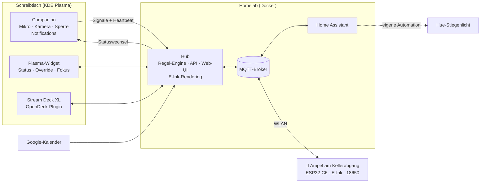
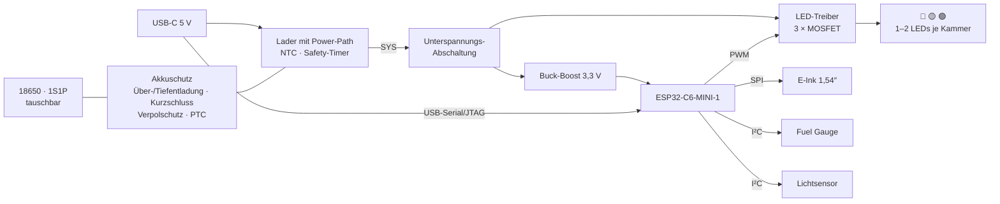

# office-traffic-light 🚦

**Eine Ampel fürs Büro im Keller.** Sie zeigt der Familie schon vom Gang aus, ob sich der Weg nach unten lohnt:
🔴 **Rot** = Meeting, bitte nicht stören · 🟡 **Gelb** = ich arbeite, komm rein, wenn's wichtig ist · 🟢 **Grün** = komm rein · ⚫ **aus** = ich bin nicht im Büro.

Der Status wird automatisch erkannt (Mikrofon/Kamera, Google-Kalender, Arbeitszeiten, Bildschirmsperre) und lässt sich jederzeit per KDE-Widget, Stream Deck oder Web-UI übersteuern. Open Source & Open Hardware: Software, Firmware, Platine (KiCad) und 3D-gedrucktes Gehäuse (OpenSCAD).

> **Status: Konzeptphase.** Dieses README ist die Projektdefinition und das Feature-Set (Stand 2026-10-29). Das Repo ist von Anfang an öffentlich, damit man dem Projekt beim Entstehen zusehen kann. Vor dem ersten Release wird alles ins Englische übersetzt.
>
> Weitere Dokumente: [Breadboard-Prototyp & Teileliste](docs/breadboard.md) · [Entwicklungsumgebung](docs/dev-setup.md)

## Signalbild

Eine Ampel, drei Kammern, wie im Straßenverkehr: oben Rot, in der Mitte Gelb, unten Grün. Die Position verrät die Bedeutung – auch ohne Farben unterscheiden zu können.

| Ampel | Zustand | Bedeutung | E-Ink-Zusatztafel (Beispiel) |
|---|---|---|---|
| 🔴 Rot | `dnd` | Meeting – bitte nicht reinkommen | „Bitte nicht stören · Meeting bis 14:30" |
| 🟡 Gelb | `working` | Ich arbeite – nur wenn's wichtig ist | „Arbeit · nächstes Meeting 15:00" |
| 🟢 Grün | `free` | Komm rein! | „Frei · nächster Termin morgen 09:00" |
| ⚫ aus | `away` | Nicht im Büro (PC gesperrt oder aus) | „Nicht im Büro" |

**Phasen**, angelehnt an die österreichische StVO (§ 38):

| Ampel | Phase | Wann |
|---|---|---|
| 🟢 blinkt | **Last Call** | N Minuten (Standard: 5) vor einem Termin – „jetzt noch schnell, gleich bin ich im Meeting" |
| 🔴 + 🟡 | **Gleich frei** | letzte N Minuten eines Termins. Rot+Gelb heißt laut StVO: Halt, gleich kommt Grün |
| 🟡 blinkt | **Störung** | Hub oder WLAN weg, Daten zu alt. Gelbblinken heißt in der StVO „Vorsicht" |
| aus + „Akku leer" | **Akku leer** | Abschaltschwelle erreicht |

Übergänge wie bei der echten Ampel: Vor Rot leuchtet kurz Gelb (≈ 3 s).

### E-Ink-Zusatztafel

Unter der Ampel sitzt ein kleines E-Ink-Display. Es zeigt **absolute Zeiten statt Countdown** („bis 14:30" statt „noch 23 min"). Dadurch ändert sich der Inhalt nur bei Statuswechseln: kein Bewegungssensor nötig, kein Strom im Stand.

```
┌────────────────────┐
│ MEETING            │
│ bis 14:30          │  ← große Schrift
│ Kamera an          │
│ dann Arbeit → 17:00│
│ ▮▮▮▯ 72 %    14:02 │
└────────────────────┘
```

1,54″, 200 × 200 Pixel. Die Farbe sagt schon die Ampel, die Tafel liefert nur das Kleingedruckte. „bis 14:30" ist ~5 mm hoch, der Rest ~2 mm: Das liest man, wenn man oben an der Stiege steht.

Inhalt: Grund, bis wann, was danach kommt, Hinweise wie „Kamera an" (nicht durchs Bild laufen), Akkustand und Stand-Zeit. Die Stand-Zeit wird alle 15 min per Teil-Refresh aktualisiert, damit eine eingefrorene Anzeige auffällt. Termintitel werden nie angezeigt.

## Feature-Set

### Must – v1

- **Ampel-Hardware:** drei Kammern (Rot/Gelb/Grün), ESP32-C6, WLAN + MQTT, 18650-Akku mit sicherer Ladeelektronik, USB-C für Laden *und* Dauerbetrieb
- **E-Ink-Zusatztafel:** bis wann, was danach kommt, Grund, Akku
- **Gehäuse als Ampel-Miniatur** (OpenSCAD) mit abnehmbarer Wandmontage
- **Automatik:**
  - Mikrofon oder Kamera aktiv → Rot
  - Google-Kalender → Rot oder Gelb, nach Regeln
  - Arbeitszeiten (inkl. österreichischer Feiertage) → Gelb
  - PC gesperrt → aus
  - sonst → Grün
- **Manueller Override mit Dauer:** von 15 min bis „bis Feierabend" oder unbegrenzt; „Auto" setzt zurück
- **KDE-Plasma-Widget** (Panel und Desktop): erkannten Status samt Grund sehen, mit Zeit übersteuern, Fokus/Pomodoro
- **Desktop-Notification** bei jeder Statusänderung
- **Last Call** und **Failsafe** (siehe Signalbild)
- **Home Assistant per MQTT-Discovery:** Status, Statuswechsel-Event, aktueller Zeitraum, nächster freier Zeitraum, Akku
- **Hub als Docker-Container** im Homelab

### Should

- Phase **„Gleich frei"** (Rot+Gelb)
- **Stream Deck XL** als Bedienpult
- **Flashen und WLAN-Einrichtung im Browser** (ESP Web Tools + Improv), OTA-Updates
- **Helligkeitsautomatik** per Lichtsensor, Nachtabsenkung
- **Restlaufzeit-Schätzung** des Akkus in HA

### Could

- Generische **Webhook-Signale**, z. B. für Claude Code (siehe unten)
- **ESPHome-Beispielconfig** für Nachbauten mit Netzteil („Bring your own lamp")
- **Prometheus-Metriken** und Grafana-Dashboard (Meeting-Statistik)
- **WLAN-6-TWT** auf dem ESP32-C6 für längere Akkulaufzeit, falls der Router es kann
- Companion für Windows/macOS, GNOME-Extension
- Mehrere Personen bzw. Ampeln
- Push „Sag mir, wenn frei" (ntfy) – für Familien, die nicht eh per WhatsApp schreiben

### Won't – bewusst nicht

| Idee | Warum nicht |
|---|---|
| Zweite Ampel an der Kellertür | Am Kellerabgang fällt die Entscheidung – eine Ampel reicht |
| Klopf-Knopf / Rückkanal | Die Familie schreibt eh per WhatsApp |
| Eigenes Bedienpult („Stellwerk") | Stream Deck XL + Widget übernehmen das |
| Bewegungsmelder / mmWave am Gerät | Die LEDs leuchten dauerhaft (Fernsicht vom Gang), das E-Ink ändert sich nur bei Statuswechseln. Ein mmWave-Sensor (~70–80 mA) würde den Akku in 1–2 Tagen leeren |
| ESP-NOW / Thread / Zigbee | WLAN ist überall gut, MQTT-Broker und HA sind vorhanden – WLAN ist einfacher |
| Countdown per LED | zu viel Strom – das E-Ink zeigt absolute Zeiten |
| Arbeit/Privat-Erkennung über Ordnerpfade, VPN o. ä. | passt nicht: alles läuft auf einem Rechner, Pfade sind individuell |
| Fertige HA-Automationen | nur Entities + Trigger; Automationen baut man sich selbst |
| RGB-LEDs (WS2812) | echte Einzelfarben, die Position codiert die Bedeutung; WS2812 ziehen auch „aus" Strom |

## Architektur



**Grundprinzip: schlauer Hub, dumme Ampel.** Der Hub entscheidet alles – Status, Phase, Blinkmuster, E-Ink-Inhalt – und publiziert es per MQTT. Die Ampel zeigt nur an, meldet Telemetrie und schaltet bei Funkstille selbstständig auf „Störung".

| Komponente | Technik | Aufgabe |
|---|---|---|
| Hub | Go, Docker, SQLite | Regel-Engine, Kalender, Arbeitszeiten, REST/WebSocket-API, Web-UI, MQTT + HA-Discovery, E-Ink-Rendering |
| Companion | Go, systemd-User-Service | Mikro/Kamera (PipeWire), Bildschirmsperre, Desktop-Notifications, OAuth-Helfer |
| Plasma-Widget | QML (Plasma 6) | Status, Override, Fokus/Pomodoro |
| Stream-Deck-Plugin | TypeScript (Elgato-SDK) | Bedienpult auf dem Stream Deck XL |
| Firmware | C, ESP-IDF | WLAN-Stromsparen, MQTT, LEDs, E-Ink, Akku |
| Projekt-Homepage | GitHub Pages (statisch) + eigene Domain | Pflicht für Googles OAuth-Branding (Beschreibung, Datenschutz, Nutzungsbedingungen), dazu Doku, Web-Flasher (ESP Web Tools braucht HTTPS) und die OAuth-Redirect-Weiche. Kein Backend, keine Nutzerdaten |
| Platine | KiCad | ESP32-C6, Ladeelektronik, LED- und E-Ink-Treiber – bestückt von JLCPCB |
| Gehäuse | OpenSCAD + BOSL2 | Ampel-Miniatur + abnehmbarer Wandhalter |

Home Assistant ist keine eigene Komponente: Der Hub meldet seine Entities per MQTT-Discovery an, HA findet sie selbst.

**Warum Go?** Ein statisches Binary pro Komponente, winzige Docker-Images, gute Bibliotheken für MQTT, D-Bus und Google-APIs – und der Companion lässt sich später für Windows/macOS cross-kompilieren.

**API-first:** Eine OpenAPI-Spec in `api/` ist der Vertrag zwischen Hub, Companion, Widget und Stream-Deck-Plugin.

| Endpoint | Zweck |
|---|---|
| `GET /api/v1/status` | aktueller Status inkl. Grund, Zeitraum, nächster freier Zeitraum |
| `GET /api/v1/timeline?from=…&to=…` | geplante Zeiträume aus Kalender + Arbeitszeiten |
| `PUT` / `DELETE /api/v1/override` | Override setzen (Status + Dauer oder Ende) / aufheben |
| `PUT` / `DELETE /api/v1/focus` | Fokus/Pomodoro starten / stoppen |
| `POST /api/v1/signals/{quelle}` | Signale von Companion und Webhooks (mit TTL) |
| `GET /api/v1/events` | Live-Updates (WebSocket/SSE) |

## Zustandslogik

Jede Quelle meldet einen *Claim*: Status, Priorität und Ablaufzeit. Der höchste gültige Claim gewinnt.

| Prio | Quelle | Ergebnis | Details |
|---|---|---|---|
| 1 | Manueller Override (Widget, Stream Deck, Web-UI, Fokus-Timer) | beliebig | läuft immer ab: nach Dauer, „bis Termin-Ende", „bis Feierabend" – oder explizit unbegrenzt |
| 2 | Mikrofon oder Kamera aktiv | `dnd` | greift nach ≥ 10 s (Entprellung), hält 2 min nach (Wiederverbinden, Nachbesprechung) |
| 3 | PC gesperrt oder Companion stumm | `away` | nur wenn Mikro und Kamera aus sind |
| 4 | Kalender-Termin | `dnd` / `working` / `away` | Regeln pro Kalender |
| 5 | Arbeitszeiten | `working` | Wochenplan, Feiertage, Urlaub aus dem Kalender |
| 6 | Webhook-Signale (optional) | meist `working` | mit TTL |
| 7 | Standard | `free` | – |

- **Mikro/Kamera schlägt Sperre:** Von Hand sperrt man während eines Calls nicht. Aber in einem Meeting, in dem man nur zuhört, rührt man die Maus nicht an, und nach ein paar Minuten sperrt sich der Bildschirm von selbst. Dann bleibt es trotzdem Rot.
- **Konflikt-Hinweis:** Läuft ein manueller Override (z. B. Grün) und das Mikro geht an, fragt die Notification: „Auf Rot schalten?"
- **Heartbeats:** Der Companion meldet sich alle 30 s. Ist er 90 s still (PC aus, Standby), gilt das wie „gesperrt".
- **Failsafe an der Ampel:** Hub offline (MQTT Last Will) oder Status zu alt → Gelb blinkt.
- **Vorausplanung:** Der Hub kennt die Zukunft (Kalender + Arbeitszeiten). Daraus berechnet er den aktuellen Zeitraum, den nächsten Wechsel und den nächsten freien Zeitraum – für E-Ink, Widget und HA.

## Signalquellen

### Companion (Linux)

- **Mikrofon:** PipeWire-Capture-Streams (`media.class = Stream/Input/Audio`) im Zustand „running". Ignoriert werden:
  - Pegelanzeigen (pavucontrol, Plasma-Lautstärke-Applet)
  - Aufnahmen vom Ausgang (Monitor-Quellen, z. B. Bildschirmaufnahme)
  - Apps auf einer konfigurierbaren Ignore-Liste
- **Kamera:** geöffnete `/dev/video*`-Geräte und PipeWire-Video-Streams.
- **Bildschirmsperre:** logind `LockedHint` bzw. `org.freedesktop.ScreenSaver`.
- **Notifications** bei jedem Statuswechsel, mit Grund („🔴 Mikrofon aktiv – Firefox") und Schnellaktionen („Falsch erkannt", „Override aufheben").
- **Referenz-Setup:** CachyOS, KDE Plasma 6 (Wayland), PipeWire.

### Google-Kalender

- **Anbindung:** Google Calendar API (empfohlen: nahezu Echtzeit, liefert `eventType`, Teilnehmer und Konferenz-Links) oder die geheime iCal-Adresse (einfacher, aber teils stark verzögert).
- **Regeln pro Kalender**, zum Beispiel:
  - Termin mit Teilnehmern oder Video-Link → `dnd`
  - `focusTime` oder Titel wie „Fokus|Blocker" → `working`
  - `outOfOffice` oder „Urlaub" → `away`
  - ganztägige und als „frei" markierte Termine → ignorieren
- **Gespiegelte Termine:** Im Referenz-Setup kopiert ein Apps Script die Arbeitstermine in den privaten Kalender. Dabei gehen Teilnehmer oft verloren. Tipp: Das Script markiert Meetings (Farbe, Präfix oder `extendedProperties`), der Hub liest die Markierung.
#### Google-Login für Selbst-Hoster

Zwei getrennte Probleme:

1. **Dauerhafte Tokens.** Solange eine OAuth-App auf „Testing" steht, laufen die Refresh-Tokens nach 7 Tagen ab. Zum **Veröffentlichen** verlangt die Google Auth Platform eine vollständige Branding-Seite: Homepage, Datenschutzerklärung, Nutzungsbedingungen und eine autorisierte Domain. Die Homepage muss die App beschreiben, eine reine Login-Seite reicht nicht. Für die Verifizierung durch Google muss die Domain außerdem nachweislich dir gehören (Search Console). → **Ohne echte Projekt-Homepage gibt es keinen Dauerbetrieb.**
2. **Redirect.** Jeder Nachbau hat seinen Hub unter einer anderen Adresse, meist ohne öffentliches HTTPS. Web-Clients brauchen aber einen HTTPS-Redirect auf eine öffentliche Domain. Ausnahme sind Desktop-Clients: Sie dürfen auf Loopback (`127.0.0.1`) zurückleiten. Den Device-Flow („Code auf einem anderen Gerät eingeben") lässt Google für Kalender-Scopes nicht zu.

**Plan:**

- **Projekt-Homepage mit eigener Domain** (GitHub Pages + Custom Domain, in der Search Console verifiziert). Darauf: Beschreibung, Logo, Screenshots, Datenschutzerklärung, Nutzungsbedingungen, Doku und Web-Flasher.
- **Stufe 1 – für den Referenz-Aufbau:** ein eigener OAuth-Client, dessen Branding auf die Projekt-Homepage zeigt. Damit lässt er sich veröffentlichen, und die 7-Tage-Grenze fällt weg. Bis zur Verifizierung zeigt Google beim Login einen Warnhinweis, und es gilt eine Obergrenze von 100 Nutzern.
- **Stufe 2 – für Nachbauten:** ein **gemeinsamer OAuth-Client des Projekts**, den Google prüft. `calendar.readonly` gilt als „sensitive", nicht als „restricted". Es braucht also eine Begründung und ein Demo-Video, aber keine kostenpflichtige Sicherheitsprüfung. Danach braucht kein Nachbauer eine eigene Google Cloud Console.
  - **Login per Companion:** Client-Typ „Desktop-App", Loopback-Redirect auf `127.0.0.1`. Bei installierten Apps behandelt Google das Client-Secret ausdrücklich nicht als Geheimnis, es darf also im Open-Source-Code stehen.
  - **Login per Web-UI ohne Companion:** eine **Redirect-Weiche** auf der Homepage, nach dem Vorbild von `my.home-assistant.io`. Google leitet auf `https://<homepage>/oauth/callback`, und die statische Seite reicht Code und `state` an die Hub-Adresse weiter, die dieser Browser vorher lokal gespeichert hat. Die Zieladresse kommt nie aus URL-Parametern, sonst wäre die Weiche ein offener Redirect. Offen ist das Client-Secret: Web-Clients brauchen es bei jedem Token-Refresh im Hub. Das prüfen wir, bevor Stufe 2 startet.
- **Fallback ohne OAuth:** die geheime iCal-Adresse des Kalenders. Dabei fehlen aber `eventType` und Teilnehmer, und Google aktualisiert den Feed teils stark verzögert.

### Arbeitszeiten

Wochenplan (z. B. Mo–Fr 08:00–17:00), Feiertage pro Land (AT voreingestellt), Urlaub und Abwesenheit aus dem Kalender.

### Webhooks (optional) – z. B. Claude Code

Jedes Tool kann per `POST /api/v1/signals/<name>` einen Claim mit TTL setzen. Beispiel für einen Claude-Code-Hook in `~/.claude/settings.json`:

```json
{
  "hooks": {
    "UserPromptSubmit": [
      {
        "hooks": [
          {
            "type": "command",
            "command": "curl -fsS -m 2 -X POST \"$OTL_URL/api/v1/signals/claude\" -H \"Authorization: Bearer $OTL_TOKEN\" -d '{\"status\":\"working\",\"ttl\":\"30m\"}' || true"
          }
        ]
      }
    ]
  }
}
```

> Als Arbeits-Signal nur bedingt zuverlässig: Sessions bleiben oft tagelang offen, laufen per SSH auf Servern, und lange Outputs liest man ohne neuen Prompt. Darum optional.

## Bedienung

### KDE-Plasma-Widget

- **Panel:** Mini-Ampel als Icon (die aktive Lampe leuchtet), Tooltip mit Grund und „bis".
- **Rechtsklick-Menü:** „Web-UI öffnen", „Auto", Schnell-Overrides.
- **Popup:**
  - erkannter Status mit Quelle („Mikrofon aktiv", „Kalender: Meeting bis 14:30")
  - Override: Rot / Gelb / Grün / Aus für 15 min, 30 min, 1 h, 2 h, bis Termin-Ende, bis Feierabend oder unbegrenzt
  - „Auto" setzt den Override zurück
  - Fokus/Pomodoro, z. B. 25/5 oder 50/10 (Arbeitsphase Gelb, Pause Grün – konfigurierbar)
  - Tagesleiste: die heutigen Zeiträume als farbiger Balken
- Läuft im Panel und auf dem Desktop; Verteilung über den KDE Store („Neue Widgets holen").
- **Andere Desktops:** Die Web-UI ist als PWA installierbar; eine GNOME-Extension wäre ein schönes Community-Projekt.

### Stream Deck XL

Plugin auf Basis des offiziellen Elgato-SDK. Unter Linux läuft es in [OpenDeck](https://github.com/nekename/OpenDeck), das Elgato-SDK-Plugins unterstützt, unter Windows/macOS in der Elgato-App. Alternative: ein Plugin für [StreamController](https://github.com/StreamController/StreamController).

Layout-Vorschlag (8 × 4) – **die linke Spalte ist die Ampel:**

| | 1 | 2 | 3 | 4 | 5 | 6 | 7 | 8 |
|---|---|---|---|---|---|---|---|---|
| **A** | 🔴 Rot | Status | bis 14:30 | nächst frei | 15 min | 30 min | 1 h | ∞ |
| **B** | 🟡 Gelb | Grund | 🎙 Mikro | 📷 Kamera | Fokus 25 | Fokus 50 | Pause 5 | ⏱ 12:34 |
| **C** | 🟢 Grün | 🔋 72 % | | | | | | |
| **D** | Auto | | | | | | | |

- Die Lampen-Tasten zeigen live, welche Lampe leuchtet. Drücken setzt einen Override (Dauer per Dauer-Taste oder langem Druck).
- Freie Tasten bleiben für andere Aufgaben.

### Web-UI

Status und Override, Tagesansicht, Regeln, Kalender-Verbindung, Arbeitszeiten, Gerätezustand (Akku, WLAN, Firmware), Verlauf.

## Home Assistant & MQTT

Der Hub legt per MQTT-Discovery nur Entities an – Automationen baut man sich selbst.

| Entity | Typ | Inhalt |
|---|---|---|
| `sensor.office_traffic_light_status` | Enum | `free`, `working`, `dnd`, `away` – Attribute: Grund, Quelle, seit, bis, Phase |
| `event.office_traffic_light_status_changed` | Event | jeder Statuswechsel (von → nach, Grund) – der Trigger für eigene Automationen |
| `sensor.office_traffic_light_slot_start` / `…_slot_end` | Zeitstempel | aktueller Zeitraum |
| `sensor.office_traffic_light_next_free_start` / `…_next_free_end` | Zeitstempel | nächster freier Zeitraum |
| `sensor.office_traffic_light_battery` | % | Akkustand, dazu Spannung und Restlaufzeit-Schätzung |
| `binary_sensor.office_traffic_light_charging` | binär | lädt / hängt am USB |
| Diagnose | – | WLAN-Signal, Firmware-Version, online |

| Topic | Inhalt |
|---|---|
| `office-traffic-light/state` | retained JSON (siehe unten) |
| `office-traffic-light/display` | retained Bitmap fürs E-Ink, vom Hub gerendert |
| `office-traffic-light/hub/online` | Last Will des Hubs → Failsafe an der Ampel |
| `office-traffic-light/device/<id>/telemetry` | Akku, Ladezustand, RSSI, Firmware |
| `office-traffic-light/device/<id>/cmd` | OTA, Neustart, Identify |

```json
{
  "status": "dnd",
  "phase": "ending_soon",
  "reason": "calendar",
  "since": "2026-10-28T14:00:00+01:00",
  "until": "2026-10-28T14:30:00+01:00",
  "next": { "status": "working", "until": "2026-10-28T17:00:00+01:00" },
  "next_free": { "start": "2026-10-28T17:00:00+01:00", "end": null },
  "light": "red_yellow",
  "updated": "2026-10-28T14:25:03+01:00"
}
```

`light` ist eines von `off`, `red`, `yellow`, `green`, `green_blink`, `red_yellow`, `yellow_blink`.

### Bring your own lamp – Beispiel

Der Hue-Bewegungsmelder am Kellerabgang löst aus, während die Ampel Rot oder Gelb zeigt → das Stiegenlicht blinkt viermal in der passenden Farbe:

```yaml
alias: Kellerabgang – Ampel-Warnung über Hue
mode: single
triggers:
  - trigger: state
    entity_id: binary_sensor.kellerabgang_bewegung
    to: "on"
conditions:
  - condition: state
    entity_id: sensor.office_traffic_light_status
    state: ["dnd", "working"]
actions:
  - variables:
      # Hue-Gelb wirkt grünlich – Orange liest sich als Ampel-Gelb
      farbe: "{{ 'red' if is_state('sensor.office_traffic_light_status', 'dnd') else 'orange' }}"
  - action: scene.create
    data:
      scene_id: kellerabgang_vorher
      snapshot_entities: [light.stiegenlicht]
  - repeat:
      count: 4
      sequence:
        - action: light.turn_on
          target: { entity_id: light.stiegenlicht }
          data: { color_name: "{{ farbe }}", brightness_pct: 100, transition: 0 }
        - delay: { milliseconds: 600 }
        - action: light.turn_off
          target: { entity_id: light.stiegenlicht }
          data: { transition: 0 }
        - delay: { milliseconds: 400 }
  - action: scene.turn_on
    target: { entity_id: scene.kellerabgang_vorher }
```

## Hardware



| Block | Kandidat | Warum |
|---|---|---|
| MCU | ESP32-C6-MINI-1 | WLAN 6 (TWT), BLE, natives USB zum Flashen, LP-Core |
| Lader | BQ24074 (alternativ MCP73871) | Power-Path: Am USB läuft das System direkt vom Netzteil, der Akku wird zur USV. Dazu NTC-Eingang, Safety-Timer, Eingangs-Überspannungsschutz |
| Akkuschutz | DW01A + FS8205A | Überladung, Tiefentladung, Überstrom/Kurzschluss |
| Verpolschutz | P-MOSFET | falls die Zelle verkehrt eingelegt wird |
| Unterspannungs-Abschaltung | Spannungswächter + Load-Switch | trennt bei ~3,0 V, schützt die Zelle bei langer Lagerung |
| 3,3 V | Buck-Boost, z. B. TPS63802 | stabile 3,3 V über den ganzen Akkubereich, auch bei WLAN-Stromspitzen |
| Fuel Gauge | MAX17048 | Akkustand in % + Entladerate → Restlaufzeit in HA |
| Lichtsensor | VEML7700 | Helligkeitsautomatik, Nachtabsenkung |
| LED-Treiber | 3 × N-MOSFET, PWM per LEDC | 1–2 SMD-LEDs pro Kammer, direkt auf der Platine. Die LEDs hängen an LP-GPIOs, damit notfalls der LP-Core im Deep Sleep blinken kann |
| LEDs | Rot ~625 nm, Gelb/Amber ~590 nm, Grün ~520 nm (oder Signalgrün ~505 nm) | Einzelfarben wie bei der echten Ampel; ausgelegt auf 20 mA, im Betrieb gedimmt |
| E-Ink | 1,54″ s/w, 200 × 200, SSD1681 (z. B. GDEY0154D67, ca. 32 × 37 mm) | Teil-Refresh; die Treiberschaltung sitzt auf unserer Platine, das Panel wird per FPC eingesteckt |
| USB-C | CC-Widerstände 5,1 kΩ, ESD-Schutz (USBLC6) | Laden, Dauerstrom, Flashen |
| Taster | Boot, Reset, Info | Info zeigt Akku/IP an; lang drücken = Setup-Modus |

### Akku & Sicherheit

Gespeist wird aus vorhandenen 18650ern aus alten Vapes. Darum ist die Schutzbeschaltung Pflicht, nicht Kür:

| Schutz gegen | Umsetzung |
|---|---|
| Überladung | Lader-IC mit sauberem CC/CV-Verfahren (4,2 V), dazu das Schutz-IC als zweite Instanz (~4,3 V) |
| Tiefentladung | dreistufig: Firmware schaltet bei ~3,3 V ab und zeigt „Akku leer" am E-Ink → Hardware-Abschaltung bei ~3,0 V → Schutz-IC bei ~2,4 V |
| Überstrom / Kurzschluss | Schutz-IC + rückstellende Sicherung (PTC) |
| Temperatur | NTC an der Zelle – geladen wird nur zwischen 0 und 45 °C |
| Verpolung | P-MOSFET |
| Endlos-Laden | Safety-Timer im Lader-IC |

**Zellen-Check vor dem Einsatz:**

- Wrap prüfen: Vape-Zellen haben oft Risse am Pluspol, das ist Kurzschlussgefahr. Neu wrappen kostet Cents.
- Keine Dellen, Beulen oder Korrosion.
- Zellen, die unter ~2 V gefallen sind, nicht mehr laden.
- Kapazität und Innenwiderstand mit einem Analyse-Ladegerät messen, schwache Zellen aussortieren und beschriften.
- Nur eine Zelle pro Gerät (1S1P). Parallele Zellen mit unterschiedlichem Ladezustand gibt's nicht.

### Energiebudget

Eine Schätzung – gemessen wird am Prototyp:

| Verbraucher | Annahme | mAh/Tag |
|---|---|---|
| WLAN verbunden + Light Sleep, solange du im Büro bist | 2–5 mA × 10 h | 20–50 |
| LEDs (eine Kammer, per Lichtsensor gedimmt) | 2–8 mA × 10 h | 20–80 |
| Away-Modus: Deep Sleep, Abfrage alle 2 min | 14 h | 5–20 |
| E-Ink, Sensoren, Ruheströme | – | 1–3 |
| **Summe** | | **≈ 45–150** |

Bei ~2.000 mAh nutzbarer Kapazität einer gebrauchten 18650 ergibt das **≈ 2–6 Wochen** pro Ladung. Mit zwei Zellen im Wechsel (eine in der Ampel, eine im Ladegerät) dauert ein Tausch 30 Sekunden.

Die WLAN-Werte stützen sich auf [Espressifs Messungen](https://docs.espressif.com/projects/esp-idf/en/v6.0/esp32/api-guides/low-power-mode/low-power-mode-wifi.html): rund 2–3 mA im Light Sleep, gemessen am klassischen ESP32 im geschirmten Raum. Im echten Heimnetz ist es eher mehr.

**Hebel, falls das nicht reicht:**

- **LED-Helligkeit** ist der größte Einzelposten; im dunklen Gang reicht wenig.
- **WLAN 6 mit TWT**, wenn der Router es kann.
- **Längeres Abfrageintervall** im Away-Modus.
- **Plan B: USB-Kabel aus dem Keller.** Dank Power-Path läuft die Ampel dann am Netzteil, und der Akku wird zur USV – ohne Umbau.

### Fertigung

- **KiCad**, 2 Lagen (4 Lagen optional für saubere Masse und HF).
- **JLCPCB mit Bestückung:** Bauteile aus dem LCSC-Katalog, möglichst „Basic Parts" (Extended Parts kosten Rüstgebühr). Alternativen gleich im Schaltplan vermerken.
- **Fertigungsdaten aus der CI** per KiBot: Gerber, Bohrdaten, BOM und Bestückungsliste im JLCPCB-Format, Schaltplan-PDF, iBOM.
- **Handarbeit danach:** E-Ink-Panel ins FPC einstecken, Zelle einlegen. Eventuell den 18650-Halter anlöten – zwei THT-Lötstellen schafft jeder Lötkolben.
- **Antenne:** Den Bereich des ESP32-C6-Moduls freihalten, also keine Masse und kein Akku darunter.
- **Grobe Kosten:** siehe [Kosten](#kosten).
- **Vorher kommt der Breadboard-Prototyp** aus fertigen Modulen ([Teileliste](docs/breadboard.md)). Die Teile sind in ein paar Tagen da, die Platine braucht Wochen. Die Firmware läuft so schon, bevor die Platine da ist, und die Strommessung hilft beim Schaltplan.

### Kosten

Grobe Schätzung vor dem Schaltplan, Stand 2026-10-29, inkl. Versand und 20 % USt. Belastbar wird das erst mit fertiger BOM.

**Entwicklung bis zur ersten Platine:**

| Posten | ca. € |
|---|---|
| Breadboard Stufe 1 (inkl. transparentem PETG) | 80–105 |
| Breadboard Stufe 2 (Akku) | 40–55 |
| Versand (BerryBase; DigiKey ab 50 € frei) | 5–10 |
| Gehäuse-Filament dunkelgrau/schwarz, falls nicht vorhanden | 20–25 |
| **bis vor die Platinenbestellung** | **≈ 150–200** |
| erste JLCPCB-Bestellung (5 Platinen, 2 bestückt) + E-Ink-Panel | 90–130 |
| optional: Nordic PPK2 – oder INA226-Logger für ~5 € (siehe [Teileliste](docs/breadboard.md)) | 100 / 5 |

**Endprodukt pro Stück** (bestückte Platine, Panel, Filament, Schrauben; Zelle aus dem Bestand):

| Bestellmenge bei JLCPCB | Platine pro Stück | Ampel gesamt |
|---|---|---|
| 2 bestückt (Einzel-Nachbau) | ~45–50 € | **~60–75 €** |
| 5 bestückt (mit Freunden) | ~25 € | **~40–50 €** |
| 30+ (Sammelbestellung/Kit) | ~13–15 € | **~25–35 €** |

Bei kleinen Mengen dominieren die Fixkosten pro Bestellung: Rüstgebühr, ~3 $ je „Extended Part", Versand, Einfuhr. Die Bauteile selbst kosten nur ~10–14 $ pro Platine.

**Hebel:**

- Basic- statt Extended-Parts, wo es geht
- Fuel Gauge weglassen (Spannung per ADC)
- Fototransistor statt VEML7700
- **Lite-Variante** ohne Akku: fertiges C6-Board + E-Ink-Modul + LEDs am USB-Netzteil, ~25–35 € plus Filament, gleiches Gehäuse
- **„Bring your own lamp"** per HA/Hue kostet gar keine Hardware

## Firmware

**ESP-IDF in C.** Für Akkubetrieb mit Dauerverbindung braucht es automatischen Light Sleep und feine Kontrolle über den WLAN-Power-Save, und das kann ESPHome nicht. Für Nachbauten mit Netzteil gibt's trotzdem eine ESPHome-Beispielconfig.

| Modus | Wann | Verhalten |
|---|---|---|
| Aktiv | du bist im Büro | WLAN bleibt verbunden (Light Sleep + Power-Save), MQTT-Dauerverbindung → ein Statuswechsel ist in ~1 s an der Ampel |
| Away | PC gesperrt | LEDs aus, Deep Sleep, Abfrage alle 2 min (einstellbar). Nach dem Entsperren geht die Ampel spätestens dann wieder an |
| Akku leer | unter der Abschaltschwelle | „Akku leer" aufs E-Ink, dann aus |
| USB | Netzteil steckt | kein Stromsparen nötig, der Akku wird geladen bzw. gehalten |

- **LEDs** über LEDC-Hardware-PWM: Dimmen, Blinken, Rot+Gelb. Die Ausgabe läuft im Light Sleep weiter (`LEDC_SLEEP_MODE_KEEP_ALIVE`; die passende Taktquelle am C6 ist noch zu verifizieren). Die Helligkeit gleicht die sinkende Akkuspannung aus.
- **E-Ink:** zeigt die vom Hub gerenderte Bitmap. Die Stand-Zeit läuft per Teil-Refresh, regelmäßig kommt ein Voll-Refresh gegen Ghosting.
- **Failsafe:** Meldet der Last Will den Hub als „offline" oder ist der Status zu alt, blinkt Gelb.
- **Telemetrie:** Akku, Ladezustand, RSSI, Firmware. Das Gerät meldet sich per MQTT-Discovery selbst in HA an.
- **Einrichtung im Browser:** [ESP Web Tools](https://esphome.github.io/esp-web-tools/) flasht über USB-C (Chrome/Edge, Web Serial) und übergibt per Improv die WLAN-Daten. Danach trägt man auf der Geräteseite den MQTT-Broker ein.
- **OTA:** per MQTT angestoßen, Images aus den GitHub Releases, automatischer Rollback bei Fehlstart.

## Gehäuse

```
   ┌─────────────┐
   │  ╭───────╮  │  ← Schute
   │  │  ROT  │  │
   │  ╰───────╯  │
   │  ╭───────╮  │
   │  │ GELB  │  │
   │  ╰───────╯  │
   │  ╭───────╮  │
   │  │ GRÜN  │  │
   │  ╰───────╯  │
   ├─────────────┤
   │ E-Ink-Tafel │  ← Zusatztafel
   └──────┬──────┘
        USB-C
```

- **Bauform:** Ampel-Miniatur mit drei Kammern und Schuten (Blendschirmen), darunter die E-Ink-Zusatztafel. Dunkelgrau oder schwarz wie das Original.
- **Anforderung:** Die Ampelfarbe muss bei gedämpftem Tageslicht (innen, kein Fenster in der Nähe) über **5 m** erkennbar sein.
- **Kompakt mit klassischen Proportionen.** Die Breite bestimmt das E-Ink-Panel: 1,54″ sind ca. 32 × 37 mm, mit Rahmen ergibt das **~45 mm**. Jede Kammer ist quadratisch, die Zusatztafel auch, so wie beim echten Signalgeber mit Zusatzschild. Alle Maße ca.:

  | Teil | Maße (B × H × T) | Anmerkung |
  |---|---|---|
  | Kammer (3×) | 45 × 45 mm | Linse Ø ~30 mm, 1–2 LEDs dahinter |
  | Zusatztafel | 45 × ~50 mm | E-Ink 1,54″ |
  | Dach | 45 × ~5 mm | |
  | **Gehäuse gesamt** | **~45 × 190 × 38 mm**, mit Schuten ~60 mm tief | eine Platine als Rückwand, 18650 stehend dahinter; ~150 g PETG + 45 g Zelle |

- **Sichtbarkeit nachgerechnet:**
  - **Größe:** Eine 30-mm-Linse erscheint auf 5 m unter ~21 Bogenminuten. Eine echte 200-mm-Ampel auf 100 m sind nur ~7. Unsere Ampel wirkt also dreimal so groß wie eine echte Ampel auf 100 Meter.
  - **Helligkeit:** Eine LED mit 5 mA (~0,3–0,5 lm) hinter 7 cm² Streuscheibe ergibt grob 100–150 cd/m². Das hebt sich im Innenraum klar ab, bei 20 mA wird es etwa viermal heller. Eine LED pro Kammer reicht also rechnerisch, den Rest regelt der Lichtsensor.
  - **Nachmessen:** Der Breadboard-Test mit 5-mm-LEDs und Linsen-Testdrucken bestätigt das.
- **Druck:** Das Gehäuse passt mit ~190 mm am Stück auf den MK3S (250 × 210 mm). Schuten, Linsen, Rückdeckel und Wandhalter sind eigene Teile.
- **Platine als Rückwand:** ~40 × 175 mm, die LEDs sitzen direkt hinter den Kammern. Es braucht keine Kabel und keine Zusatzplatinen. Größer als 100 × 100 mm kostet bei JLCPCB nur ein paar Dollar mehr.
- **Montage:** Bei ~200 g halten auch Klebestreifen. Auf der Stiege mit Kindern bleiben Schrauben oder Kabelbinder trotzdem die robustere Wahl.
- **Größere Varianten** lassen sich über Parameter einstellen. Mit 2,13″ (ca. 59 × 29 mm) wird das Gehäuse ~70 mm breit und ~240 mm hoch, das ist auf dem MK3S knapp. Mit 2,9″ (ca. 79 × 37 mm) wird es ~100 mm breit und ~365 mm hoch. Das muss man in Kammern teilen, und Linsen mit 72 mm brauchen LED-Ringe.
- **Linsen aus transparentem PETG**, als eigene flache Teile gedruckt, 0,8–1,2 mm dick, mit Streuscheiben-Struktur auf der Innenseite. Dazu:
  - ein weißer Reflektor-Trichter hinter der Linse
  - lichtdichte Trennwände, damit Rot nicht ins Gelb leuchtet

  Ein Linsen-Testdruck mit verschiedenen Stärken und Mustern zeigt, was am besten aussieht. Stärkere LEDs braucht es dafür nicht.
- **Auf FDM und den Prusa MK3S optimiert**, also einfache Geometrie, die sich leicht drucken lässt:
  - jedes Teil hat eine flache Seite fürs Druckbett und druckt **ohne Stützmaterial**
  - Überhänge höchstens 45°, Brücken höchstens ~10 mm, liegende Bohrungen in Tropfenform
  - am Druckbett Fasen statt Rundungen (kein Elefantenfuß-Problem)
  - Wandstärken als Vielfache der Linienbreite (0,45 mm → 1,35 / 1,8 mm)
  - Toleranzen als Parameter, kalibriert per Testdruck: ~0,2 mm für Schiebe-, ~0,1 mm für Presspassungen
  - Schrauben (M2,5/M3) in gedruckte Dome oder Gewindeeinsätze, ansonsten Rastnasen
  - ein Extruder: Linsen sind eigene Teile, Schrift und Logo kommen per Farbwechsel am Layer (M600)
- **Rückseite:** Akkufach hinter der Platine, USB-C unten (Laden am Platz per Powerbank geht auch), Fenster für den Lichtsensor, Taster hinter Pin-Löchern. Die Antenne des ESP32-C6-Moduls sitzt am oberen Platinenrand, ohne Zelle dahinter.
- **Wandhalter, abnehmbar** – eine eigene Platte mit
  - Schlüssellöchern für Schrauben,
  - glatter Fläche für ablösbare Klebestreifen (tesa Powerstrips, Command),
  - Schlitzen für Kabelbinder.

  Die Ampel wird von oben eingehängt (Schwalbenschwanz + Rastnase) und zum Laden oder für den Zellentausch einfach abgehoben. Optional gibt's eine Mastschelle fürs Stiegengeländer.
- **Parametrisch mit OpenSCAD + BOSL2:** Maßstab, Display-Größe, Halterungstyp und Toleranzen lassen sich einstellen. Die Dateien sind Customizer-kompatibel und passen damit auch zum OpenSCAD-Konfigurator auf MakerWorld.
- **Iteration:**
  1. Toleranz-Testdruck: Einhängung, Rastnase, Linsensitz, USB-C-Ausschnitt, Gewindeeinsätze
  2. Linsen-Lichttest
  3. Gehäuse v1 → Fotos → Anpassung
- **Werkzeug:** eine aktuelle OpenSCAD-Version mit Manifold-Backend (bei Bedarf Snapshot/Nightly) – rendert um Größenordnungen schneller.

## Sicherheit & Datenschutz

- Alles läuft lokal. Die einzige externe Verbindung ist die Google Calendar API.
- Der Companion schickt nur Ja/Nein-Signale und App-Namen, niemals Audio oder Video.
- Termintitel bleiben im Hub. E-Ink, MQTT und HA sehen nur Kategorien wie „Meeting".
- Eigene API-Tokens pro Client (Companion, Widget, Stream Deck, Webhooks), MQTT mit Benutzer und Passwort, TLS optional.

## Open Source

```
office-traffic-light/
├── api/          OpenAPI-Spec – Vertrag zwischen allen Komponenten
├── hub/          Go – Regel-Engine, API, Web-UI, MQTT, HA-Discovery, E-Ink-Rendering
├── companion/    Go – Linux-Daemon: PipeWire, Sperre, Notifications, OAuth
├── plasmoid/     QML – KDE-Plasma-6-Widget
├── streamdeck/   TypeScript – Stream-Deck-Plugin (Elgato-SDK)
├── firmware/     C – ESP-IDF; esphome/ mit Beispielconfig für Netzteil-Nachbauten
├── hardware/     KiCad – Schaltplan, Layout, Fertigungsdaten
├── enclosure/    OpenSCAD + BOSL2 – Gehäuse, Wandhalter, Testdrucke
├── site/         Projekt-Homepage (GitHub Pages) inkl. Web-Flasher
└── docs/         Doku, HA-Beispiele, Bauanleitung, Fotos
```

- **CI/CD (GitHub Actions):**
  - Hub als Multi-Arch-Docker-Image (amd64/arm64) nach GHCR
  - Companion-Binaries, später ein AUR-Paket
  - Widget als `.plasmoid` für den KDE Store
  - Stream-Deck-Plugin-Paket
  - Firmware-Build mit Web-Flasher auf GitHub Pages
  - KiBot: Gerber, BOM/CPL für JLCPCB, Schaltplan-PDF, iBOM, 3D-Renders
  - OpenSCAD: STL/3MF mit Vorschaubildern
- **Lizenzen (Vorschlag):**
  - Software: Apache-2.0
  - Hardware und Gehäuse: CERN-OHL-S-2.0
  - Doku: CC BY-SA 4.0
- **Abgrenzung:** Busylights (Luxafor, Kuando), PresenceLight und unzählige „On Air"-Lampen zeigen meist nur „im Call ja/nein" am Schreibtisch. Hier geht's um die Familie: eine Ampel, die man aus der Ferne sieht, mit Zeitangaben, dazu eine Regel-Engine mit vielen Quellen und Failsafe, Linux first und akkutaugliche Open Hardware.

## Roadmap

| Meilenstein | Inhalt |
|---|---|
| **M0 – Software-Kern** | Hub (Override, Arbeitszeiten, Kalender, Regeln, MQTT/HA), Companion, Plasma-Widget. Als Ampel dient vorerst eine Hue-Lampe über HA → 1–2 Wochen Familientest, ganz ohne neue Hardware |
| **M1a – Breadboard** | [Prototyp aus fertigen Modulen](docs/breadboard.md): Firmware, LEDs + Linsen-Test, E-Ink, Strommessung, danach Akku-Betrieb. Läuft parallel zu M0 |
| **M1b – Platine + Gehäuse v1** | KiCad-Schaltplan + Layout + Review auf Basis der Messwerte, Bestellung bei JLCPCB, Toleranz-Testdrucke, Gehäuse v1 |
| **M2 – Feinschliff** | Strommessung und Optimierung (Light Sleep, Away-Modus, TWT), E-Ink-Layouts, Stream-Deck-Plugin, Web-Flasher, OTA |
| **M3 – Release** | Englische Doku, CI, KDE Store, Printables/MakerWorld, Docker-Image, optional OSHWA-Zertifizierung |

## Offene Fragen

1. **Montageort:** Fotos von Kellerabgang und Gang. Wie lang ist die Sichtlinie? Davon hängen LED-Helligkeit und Gehäusegröße ab.
2. **Kalender:** Kann das Spiegel-Script Meetings markieren? Welche Kalender soll der Hub lesen?
3. **Fokus:** Ist die Pomodoro-Arbeitsphase Gelb oder Rot?
4. **Sperre vs. Override:** Soll das Sperren des PCs einen laufenden manuellen Override beenden? Vorschlag: nein, Overrides laufen ohnehin ab.
5. **E-Ink:** 1,54″ (entschieden 2026-10-29). Am Breadboard prüfen, ob der Text oben an der Stiege gut lesbar ist.
6. **Zellen:** Welche 18650er sind es (Typ, Alter)? Gibt's ein Ladegerät mit Kapazitätstest?
7. **Router:** Kann er WLAN 6 mit TWT (Hersteller/Modell)?
8. **Homelab:** Gibt's einen Reverse Proxy mit HTTPS-Domain? Für OAuth nicht mehr nötig (Desktop-Client + Loopback), aber angenehm für Web-UI und PWA.
9. **Lizenzen** bestätigen. Bis eine `LICENSE`-Datei im Repo liegt, darf rechtlich niemand den Code weiterverwenden.
10. **Projekt-Domain:** welche Domain für die Homepage (nötig fürs Google-OAuth-Branding)?

## Risiken

| Risiko | Gegenmaßnahme |
|---|---|
| Reale Akkulaufzeit (Heimnetz-Broadcasts, LED-Helligkeit) | früh am Devboard messen; Plan B (USB) ist eingebaut |
| LEDC-Ausgabe im Light Sleep am C6 | früh verifizieren; Fallback: LED-Treiber-IC mit eigener PWM |
| Gebrauchte Zellen | konsequent prüfen und aussortieren |
| Fehlalarme bei der Mikro-Erkennung | Ignore-Liste, „Falsch erkannt"-Aktion in der Notification |
| Google-OAuth ist fummelig | Schritt-für-Schritt-Anleitung mit Screenshots; iCal-Adresse als Fallback |
| Teile bei JLCPCB/LCSC nicht lieferbar | Alternativen im Schaltplan vermerken |
| Plugin läuft nicht sauber in OpenDeck | früh testen; Fallback: StreamController-Plugin |

## Entscheidungslog

| Datum | Entscheidung | Grund |
|---|---|---|
| 2026-10-27 | Projektstart als Brainstorming | – |
| 2026-10-28 | Eine Ampel am Kellerabgang statt zwei | dort fällt die Entscheidung |
| 2026-10-28 | WLAN + MQTT statt ESP-NOW/Thread | WLAN überall gut, Broker und HA vorhanden |
| 2026-10-28 | LEDs leuchten dauerhaft, solange du im Büro bist; kein Bewegungsmelder | Fernsicht vom Gang |
| 2026-10-28 | E-Ink mit absoluten Zeiten statt LED-Countdown | Strom; kein Sensor nötig |
| 2026-10-28 | 18650-Akku + USB-C mit Power-Path | vorhandene Zellen; Plan B Dauerstrom ohne Umbau |
| 2026-10-28 | Kein Klopf-Knopf, kein eigenes Bedienpult | WhatsApp; Stream Deck + Widget |
| 2026-10-28 | HA: nur Entities + Trigger | Automationen baut man sich selbst |
| 2026-10-28 | Claude-Code-Hooks nur optional | als Arbeits-Signal unzuverlässig |
| 2026-10-28 | Platine mit Bestückung (JLCPCB), Gehäuse in OpenSCAD | kein SMD-Löten möglich; Wunsch |
| 2026-10-28 | Go (Hub/Companion), C/ESP-IDF (Firmware) | Single Binary + Docker; volle Kontrolle übers Stromsparen |
| 2026-10-29 | Linsen aus transparentem PETG | sieht am echtesten aus, wenig Lichtverlust |
| 2026-10-29 | Gehäuse nur wenig größer als die Elektronik, auf FDM optimiert | kompakt, leicht zu drucken, einfache Geometrie |
| 2026-10-29 | Erster Prototyp auf dem Breadboard, Platine danach | Module sind in Tagen da, die Platine in Wochen; Messwerte fließen in den Schaltplan |
| 2026-10-29 | Google: Projekt-Homepage mit eigener Domain; zuerst eigener Client, später gemeinsamer verifizierter Projekt-Client (Companion-Loopback + Redirect-Weiche à la Home Assistant) | Google verlangt fürs Veröffentlichen Homepage, Datenschutz und Nutzungsbedingungen; im Testing laufen Tokens nach 7 Tagen ab |
| 2026-10-29 | Projekt-Homepage auf GitHub Pages, ohne Backend | OAuth-Branding, Doku, Web-Flasher, Redirect-Weiche |
| 2026-10-29 | E-Ink 1,54″ statt 2,9″, kompakte Ampel ~45 × 190 mm | 5 m Erkennbarkeit reichen mit 30-mm-Linsen; druckt am Stück, eine LED pro Kammer, eine Platine; billiger. (Kurz verworfen: große Ampel 100 × 365 mm mit 2,9″ – drei Druckteile, LED-Ringe, mehr Strom) |
| 2026-10-29 | Repo öffentlich ab Tag 1 | man soll dem Projekt beim Entstehen zusehen können |
