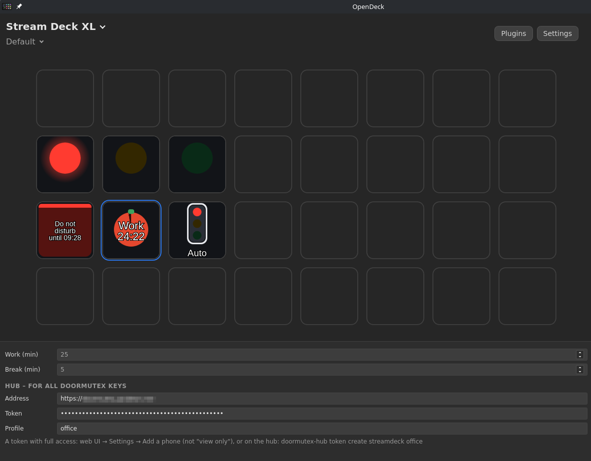

# Stream Deck on Linux

There are two ways to switch the light from a Stream Deck: the **plugin** with live keys, or plain **"run command" keys** calling the companion.

## The plugin

See [streamdeck/README.md](../streamdeck/README.md): lamp keys that light up with the light, automatic, status and pomodoro. It runs in [OpenDeck](https://github.com/nekename/OpenDeck) on Linux and in Elgato's app on Windows/macOS.

The Stream Deck needs a udev rule to be usable without root. The file and instructions are in the [OpenDeck README](https://github.com/nekename/OpenDeck); a Flatpak can't install udev rules itself.

## "Run command" keys

Since the companion has [command-line controls](../companion/README.md#controls-from-the-command-line), any Stream Deck software that can run a command can switch the light – e.g. [StreamController](https://github.com/StreamController/StreamController), which doesn't run Elgato plugins:

| Key | Command |
|---|---|
| 🔴 red | `doormutex-companion set red` |
| 🔴 30 min | `doormutex-companion set red 30m` |
| 🟡 yellow | `doormutex-companion set yellow` |
| 🟢 green | `doormutex-companion set green` |
| ⚫ off | `doormutex-companion set off` |
| auto | `doormutex-companion set auto` |
| 🍅 25 | `doormutex-companion pomodoro 25` |
| 🍅 stop | `doormutex-companion pomodoro stop` |

These keys don't show the live state – that's what the plugin is for.

## Why OpenDeck and a Go binary

| | [OpenDeck](https://github.com/nekename/OpenDeck) | [StreamController](https://github.com/StreamController/StreamController) |
|---|---|---|
| Plugin format | Elgato SDK plugins (WebSocket protocol) | own Python plugin API |
| Platforms | Linux, Windows, macOS – and the same plugin runs in Elgato's app | Linux only |
| Live keys | yes (`setImage`/`setTitle`) | yes |

One plugin for every OS decided it. Elgato plugins are usually Node.js, but the OpenDeck Flatpak has no Node.js, so the plugin is a native binary per platform (the manifest's `CodePaths`) – written in Go next to the companion, reusing its hub client.
