# Wiring the breadboard prototype

Step by step, for both stages of the [breadboard prototype](breadboard.md): **stage 1** on USB power (LEDs, e-paper, light sensor), **stage 2** on an 18650 cell (charger, protection, fuel gauge). Parts and where to order them are in the [parts list](breadboard.md#parts-list).

▶ **Video:** the same steps, animated (about 2 minutes, no sound): [doormutex.org/video/wiring.mp4](https://doormutex.org/video/wiring.mp4). Its source is in [`wiring/video/`](wiring/video/) (HyperFrames).

The pins are the firmware's breadboard defaults (`idf.py menuconfig → doormutex → Pins`, see [firmware/README.md](../firmware/README.md#pins-breadboard-defaults)). The drawings are generated by [`wiring/wiring.mjs`](wiring/wiring.mjs); change pins there and run `node docs/wiring/wiring.mjs`.

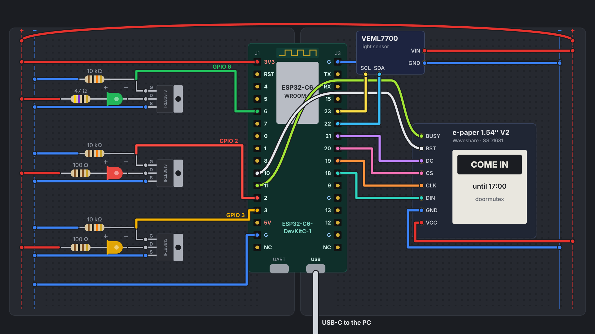

## Pins

| Function | DevKit pin | GPIO | Header |
|---|---|---|---|
| Red / yellow / green LED (MOSFET gate) | 2 / 3 / 6 | 2 / 3 / 6 | J1 |
| E-paper DIN / CLK / CS / DC | 18 / 19 / 20 / 21 | 18 / 19 / 20 / 21 | J3 |
| E-paper RST / BUSY | 10 / 11 | 10 / 11 | J1 |
| I²C SDA / SCL (light sensor, fuel gauge) | 22 / 23 | 22 / 23 | J3 |
| Charger CHG / PGOOD (stage 2) | 7 / RX | 7 / 17 | J1 / J3 |
| 3.3 V, GND | 3V3, G | – | J1 pin 1, J1 pin 15, J3 pin 1 |

Kept free: GPIO 4, 5, 8, 9, 15 (strapping pins; 8 is the DevKit's RGB LED, 9 the BOOT button), 0/1 (32 kHz crystal later), 12/13 (native USB), 16 (TX: boot messages).

## Before you start

- **Two breadboards side by side.** The DevKit is so wide that on a single 830 board no free contacts remain next to its pins. Across two boards it bridges the gap, and each header gets its own board.
- **Solder the headers** onto the Adafruit boards (VEML7700, bq24074, MAX17048) and the Pololu regulator – through-hole, no SMD.
- **Rails:** the outer rail on each side is + (3.3 V), the inner one − (GND). The drawings only show the rails in use.
- **Long leg = +.** LEDs: the long leg (anode) points to the resistor, the flat side of the rim (cathode) to the MOSFET.
- **MOSFET IRLB3813:** with the printed side facing you and the legs pointing down, the legs are **G D S** from left to right. In the drawings the MOSFETs lie on their side, legs to the left: G at the top.
- **Measuring current:** jumper **J5** on the DevKit sits in the 3.3 V supply of the module. Pull it and put an ammeter in its place to measure only the ESP32-C6.

## Stage 1 – USB power

### Step 1: rails

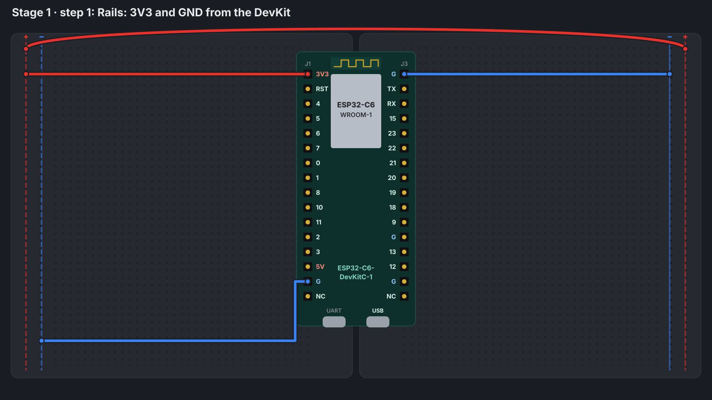

- DevKit **3V3** (J1, pin 1) → left + rail.
- DevKit **G** (J1, pin 15) → left − rail.
- DevKit **G** (J3, pin 1) → right − rail.
- Bridge the two + rails with a long jumper.

### Step 2: MOSFETs with pull-downs

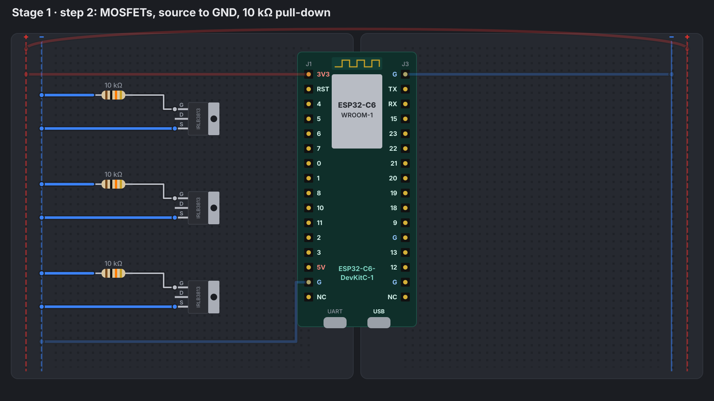

Three MOSFETs, one per colour. For each:

- **S** → − rail.
- **10 kΩ** from **G** to the − rail. It keeps the LED dark while the ESP32 boots and the pin still floats.

### Step 3: LEDs with series resistors

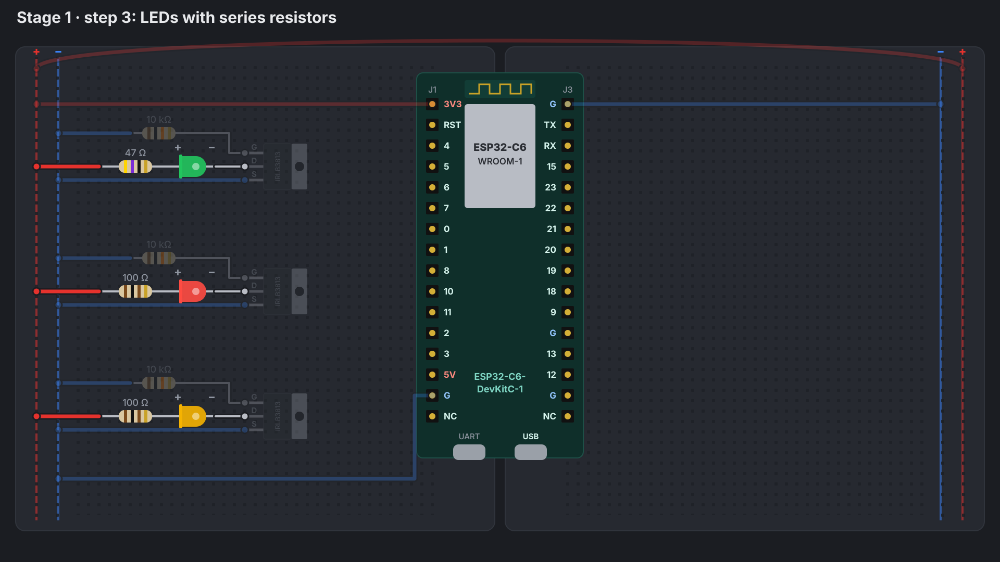

From the + rail through the resistor into the LED's long leg; the LED's short leg to **D**.

| LED | Resistor | Current at 3.3 V |
|---|---|---|
| green (VF ~2.9 V) | 47 Ω (yellow violet black) | ~5–10 mA, depending on VF |
| red (VF ~2.0 V) | 100 Ω (brown black brown) | ~13 mA |
| yellow (VF ~2.1 V) | 100 Ω (brown black brown) | ~12 mA |

The rail runs at 3.3 V on purpose: that's roughly the cell voltage just before cut-off, the worst case for the green LED with its high forward voltage. All three stay below the 20 mA the LEDs are rated for.

### Step 4: gates to the GPIOs

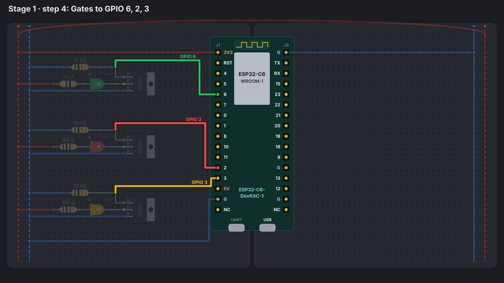

- green gate → **GPIO 6**
- red gate → **GPIO 2**
- yellow gate → **GPIO 3**

All three are LP GPIOs: later the ESP32's low-power core could blink them while the main core sleeps.

### Step 5: e-paper module

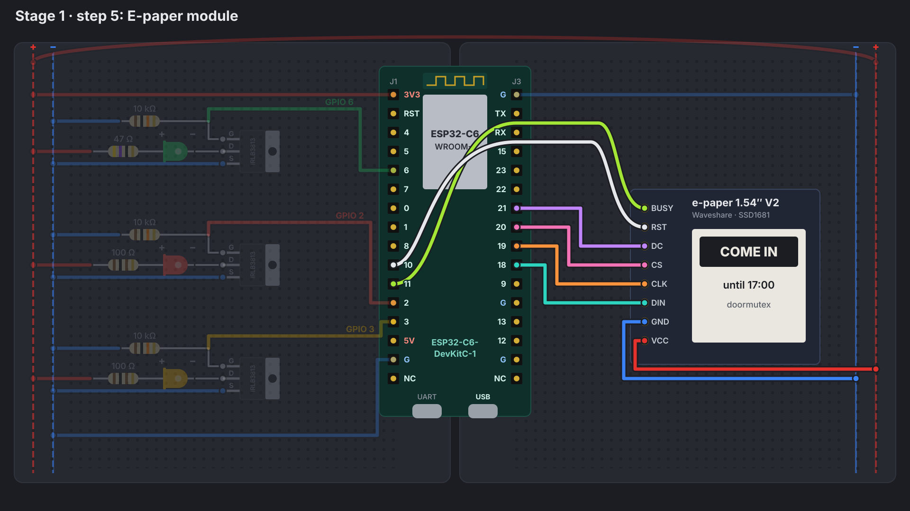

The Waveshare module comes with an 8-wire cable, labelled on the board.

| Module | DevKit |
|---|---|
| VCC | + rail (3.3 V) |
| GND | − rail |
| DIN | GPIO 18 |
| CLK | GPIO 19 |
| CS | GPIO 20 |
| DC | GPIO 21 |
| RST | GPIO 10 (left header) |
| BUSY | GPIO 11 (left header) |

RST and BUSY sit on the other header: two jumpers across the DevKit.

### Step 6: light sensor

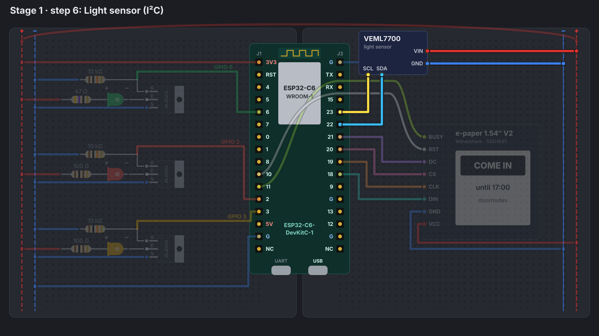

VEML7700 with the STEMMA QT to pin cable: **red** → + rail, **black** → − rail, **blue** (SDA) → GPIO 22, **yellow** (SCL) → GPIO 23. The board has its own pull-ups.

### Step 7: USB

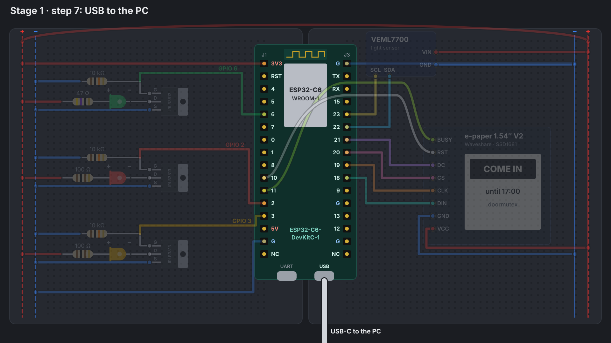

USB-C cable from the PC into the DevKit port marked **USB** (not UART): flashing, console and Improv run over the C6's native USB. Then flash and set up as in [firmware/README.md → Setup](../firmware/README.md#setup).

**Check:** the LEDs stay dark for up to a minute after boot, then show the hub's state. The e-paper shows the sign.

## Stage 2 – battery

Safety first: [breadboard → safety for the battery build](breadboard.md#safety-for-the-battery-build-stage-2). The stage 1 wiring stays; the drawings hide it so the new parts are easier to see. Flash the firmware with the charger pins (step 12) **before** you start: in stage 2 the DevKit's USB stays unplugged.

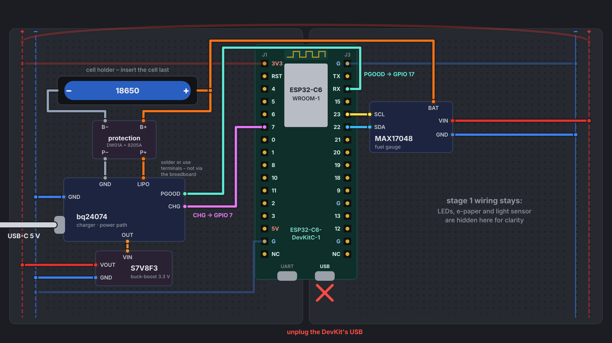

### Step 8: cell holder and protection board

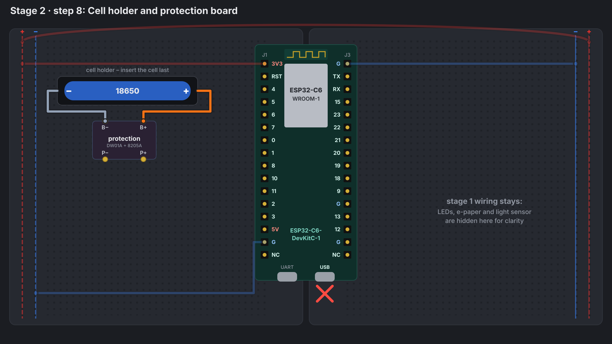

- Holder **+** → protection **B+**, holder **−** → **B−**.
- Solder the leads or use screw or lever terminals – not the breadboard, its contacts are only good for about 1 A.
- **Don't insert the cell yet.**

### Step 9: charger

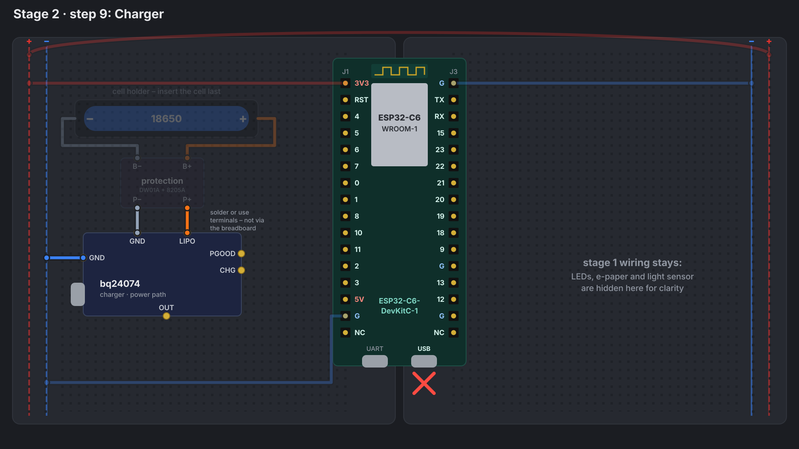

- Protection **P+** → bq24074 **LIPO**, **P−** → bq24074 **GND** (again soldered or with terminals).
- bq24074 **GND** → − rail.
- Leave the board's defaults: 1 A charge current, THERM jumper closed (no thermistor).

### Step 10: fuel gauge

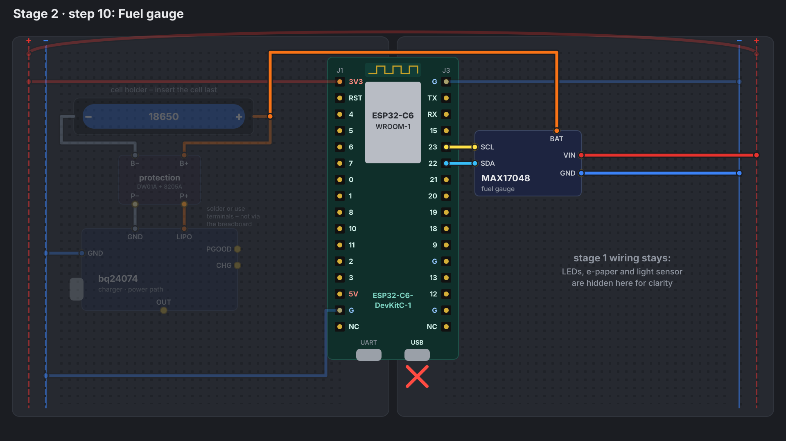

- MAX17048 **BAT** → the cell's + lead (between holder and protection board, i.e. B+). The gauge measures the cell voltage there.
- **VIN** → + rail, **GND** → − rail.
- **SCL** → GPIO 23, **SDA** → GPIO 22 – the same pins as the light sensor; both share the I²C bus (addresses 0x36 and 0x10).

### Step 11: buck-boost

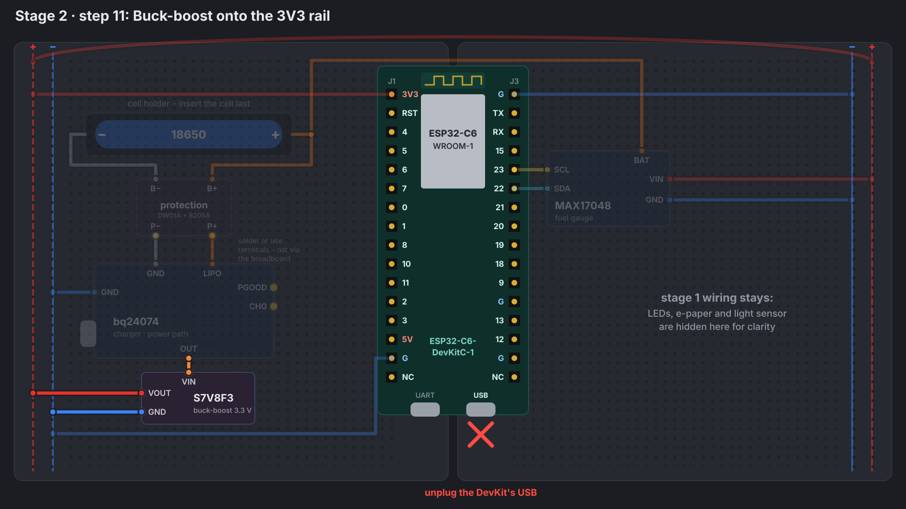

- bq24074 **OUT** → S7V8F3 **VIN**.
- S7V8F3 **VOUT** → left + rail, **GND** → − rail.
- From now on the + rail feeds the DevKit through its 3V3 pin (the wire from step 1). **The DevKit's USB stays unplugged** – otherwise its own regulator and the buck-boost both drive the 3.3 V rail.
- The LEDs stay on the 3.3 V rail. Because the LED supply no longer follows the cell, set `menuconfig → doormutex → LEDs → Supply voltage the series resistors are sized for` to **5000** mV; otherwise the firmware dims the LEDs as the cell voltage rises.

### Step 12: charge status

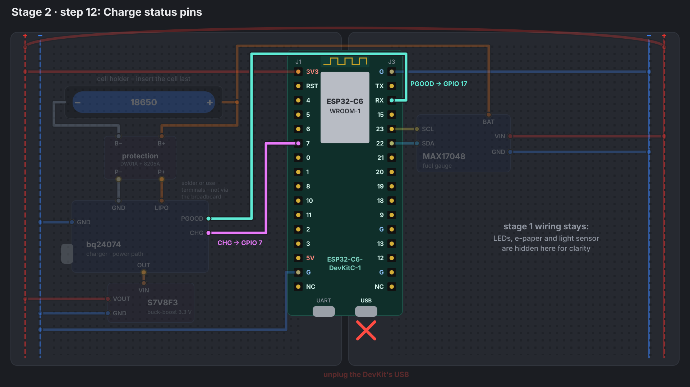

- bq24074 **CHG** → **GPIO 7**, **PGOOD** → **GPIO 17** (pin RX on the right header).
- Both are open drain and active low; the firmware turns on the internal pull-ups.
- Set the pins in `menuconfig → doormutex → Pins`: Charger CHG = 7, Charger PGOOD = 17. The default (−1, off) is right for stage 1: without a PGOOD pin and a gauge, the firmware assumes USB power.

### Step 13: power up

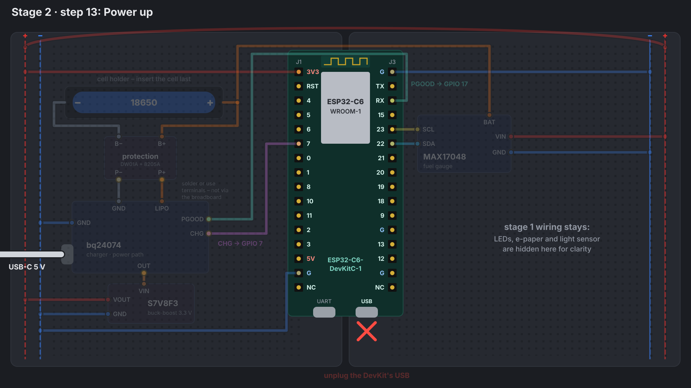

1. USB-C into the **bq24074** (not the DevKit). The PGOOD LED on the charger lights up, the light boots.
2. Insert the cell. The CHG LED lights up while it charges.
3. Unplug USB: the light keeps running on the cell without a reset – that's the power path.

**Check:** Home Assistant shows the battery level and "charging" / "USB power". For the console you need the DevKit's USB again: pull the buck-boost's VOUT wire first (step 11).

## Notes

- **Pins on the PCB:** the assignment here becomes the schematic once the breadboard has confirmed it.
- **LED supply:** the stage 2 drawings keep the LEDs on 3.3 V. The PCB plan feeds them from the cell after the under-voltage cut-off. Whether the green LED still reaches its brightness there near cut-off is exactly what stage 1 (LED rail at 3.3 V) measures.
