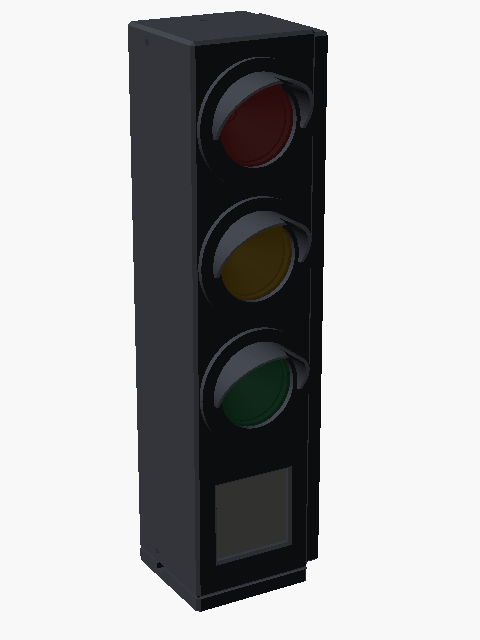
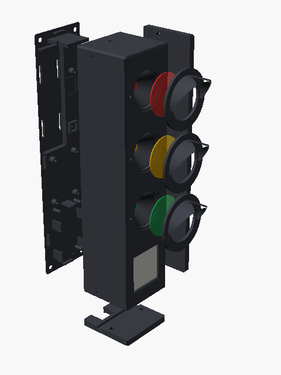
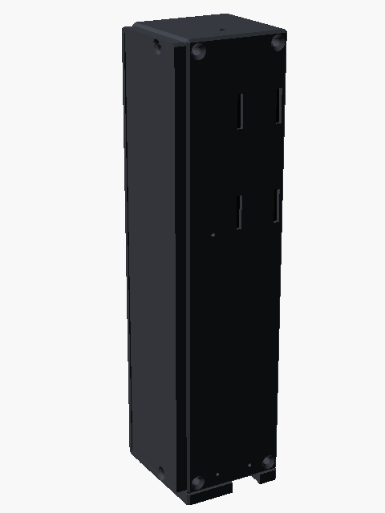

<!--
SPDX-FileCopyrightText: 2026 The doormutex contributors
SPDX-License-Identifier: CC-BY-SA-4.0
-->

# Enclosure v0

A parametric miniature traffic light in OpenSCAD for the **breadboard build** – ready-made modules from the [parts list](../docs/breadboard.md), no custom PCB yet. Everything prints without supports on a Prusa MK3S (PETG, 0.4 mm nozzle).

<p>



</p>

**Status: v0, untested.** Module dimensions are taken from datasheets or are educated guesses – every value marked `TODO verify` in [`doormutex.scad`](doormutex.scad) must be measured on the real part before printing more than a test piece.

## Parts

| Part (`part=`) | Qty | Material | On the bed | Notes |
|---|---|---|---|---|
| `front` | 1 | PETG, dark grey/black | front face | shell with three reflector cones, chamber walls, display window, corner ribs for all screws |
| `back` | 1 | PETG, dark grey/black | outer face | back cover; carries DevKit, charger, fuel gauge, buck-boost, light sensor, cell holder, info button |
| `visor` | 3 | PETG, dark grey/black | ring | clamps the lens; fixed with two filament dowels |
| `diffuser` | 3 | transparent PETG | smooth side | 1 mm lens with concentric rings inside |
| `foot` | 1 | PETG, dark grey/black | contact face | 2 magnets, USB-C slot, groove for a cable tie |
| `side_plate` | 0–1 | PETG, dark grey/black | contact face | 4 magnets for a steel railing; `side_plate = "right"`, `"left"` or `"none"` |

`part="assembly"`, `"exploded"` and `"collisions"` are views and a check, not printable.

## To buy

| Item | Qty | Note |
|---|---|---|
| Neodymium disc magnets **Ø 12 × 3 mm**, N42–N52 | 2 (foot) + 4 (side plate) | other sizes: change `magnet_d` / `magnet_h` |
| Heat-set inserts M3, short (e.g. M3 × 5.7 mm, 4.0 mm hole) | 4 | or `cover_screw = "self_tap"` and plain M3 screws |
| M3 × 8 countersunk | 4 | back cover |
| M3 × 10 countersunk | 2 + 2 | foot, side plate (cut their own thread in the ribs) |
| M2 × 5 | 4 | e-ink module |
| M2.5 × 5 | 6–8 | charger, fuel gauge, light sensor |
| Rubber or silicone sheet, 0.5–1 mm | ~45 × 45 mm + 40 × 190 mm | anti-slip pad for the contact faces |
| Velcro strap, 10–12 mm | ~25 cm | holds the cell holder |
| 1.75 mm filament | 6 × 3 mm | dowels for the visors |
| 5 mm LEDs red / yellow / green | 1 each | from the breadboard kit |

## Print settings

- **Layer height 0.2 mm**, 4 perimeters (walls are 1.8 mm = 4 × 0.45 mm), 15–20 % infill. The shell prints front face down: smooth, sharp front, no supports.
- **Lenses:** transparent PETG, 100 % infill, smooth side on a smooth sheet. Try `lens_t` 0.8–1.2 and `diffuser_pitch` in a test print.
- **Embedded magnets** (`magnet_embed = true`, default): add a *pause* (M601) at the first layer above **4.25 mm** (4.4 mm at 0.2 mm layers) for the foot and the side plate. Check in the slicer preview that the pockets are still open in the layer below. Drop the magnets in and resume – no glue needed. The magnets stick to the MK3S steel sheet through the skin; that is harmless but makes removal a bit harder.
- With `magnet_embed = false` the pockets are open and the magnets go in with a drop of CA glue or epoxy.
- **Tolerances:** `tol` (sliding fits, default 0.2) and `press_tol` (LEDs, 0.1). Calibrate both with a test print before the full shell.

## Assembly

1. Push the three LEDs into the cones from behind until the flange sits on the cone; bend the leads.
2. Screw the e-ink module onto its standoffs behind the window (M2).
3. Insert the lenses from the front (rings inwards), put two dowels into each visor, press the visors on.
4. Melt the inserts into the four corner ribs.
5. Mount the modules on the back cover:
   - DevKit with the component side towards the cover, USB-C at the bottom: it snaps under the lip at the top edge;
   - charger, fuel gauge, light sensor (on the bracket, sensor facing up to the window in the top wall);
   - buck-boost on a foam pad in the marked frame, info button in its frame;
   - cell holder with a velcro strap through the four slots.
6. Wire everything, close the cover with four M3 × 8.
7. Glue the rubber pads into the recesses of the foot and side plate, screw them on (M3 × 10).

Charging in place: the foot's slot leaves the USB-C socket open towards the back. On top of a post an angled (90°) plug fits; with a straight cable, lift the light off.

## Parameters

All parameters are Customizer-compatible (also the MakerWorld configurator). The most important ones:

| Parameter | Default | What |
|---|---|---|
| `width`, `chamber_h`, `sign_h`, `roof_h` | 45, 45, 52, 5 | outer size; height = roof + 3 chambers + sign = 192 mm |
| `depth` | 45 | incl. back cover; the breadboard modules need it, the PCB version will be ~38 |
| `wall`, `front_wall` | 1.8, 2.4 | wall thicknesses |
| `lens_d`, `lens_t`, `cone_depth` | 30, 1.0, 15 | lens and reflector |
| `visor_len`, `visor_cover`, `visor_slant` | 15, 200°, 35° | visor shape |
| `eink_*` | Waveshare 1.54″ V2 | module, panel and active area, mounting holes |
| `devkit`, `usb_x`, `devkit_buttons` | ESP32-C6-DevKitC-1 | board size, USB-C socket, pin holes for BOOT/RESET |
| `charger`, `holder`, `gauge`, `boost`, `als` | Adafruit / Pololu modules | footprints on the back cover |
| `magnet_d`, `magnet_h`, `magnet_skin`, `magnet_embed` | 12, 3, 0.6, true | magnet pockets |
| `foot_magnets`, `side_magnets` | 2, 4 positions | where the magnets go |
| `side_plate` | `right` | `none`, `left`, `right` |
| `tol`, `press_tol` | 0.2, 0.1 | fits |

## Mass and holding force

Volumes from the exported STL files (upper bound: 100 % infill, PETG 1.27 g/cm³):

| | g |
|---|---|
| front 75, back 23, foot 9, 3 visors 8, 3 lenses 3 | **~118** |
| side plate | 43 |
| electronics (DevKit, e-ink, charger, holder, sensors, wires) | ~40 |
| 18650 cell | ~45 |
| magnets (2.5 g each) | 5 / 15 |
| **total**, foot only / with side plate | **~210 / ~260** |

With real infill the printed parts weigh ~20–30 % less. On the side wall the magnets carry ~2.6 N through friction: with a rubber pad (μ ≈ 0.6) and a safety factor of 3 they need ~13 N pull (~1.3 kg), without a pad ~2.6 kg. Four Ø 12 × 3 mm discs are rated 2.5–3.5 kg each on thick steel; behind 0.6 mm PETG and a 1 mm pad expect only a quarter to a third of that – still ~2.5–3.5 kg in total. The [hardware notes](../hardware/README.md#magnet-mount) explain the estimate; the tolerance print checks it on the real railing.

## Verify before printing (`TODO verify` in the source)

- Waveshare 1.54″ V2: outline 33 × 48 mm (mounted rotated), panel position and thickness, active-area offset, mounting holes.
- ESP32-C6-DevKitC-1: outline, position of the USB-C socket used (`usb_x`), BOOT/RESET positions, free areas for the posts and the snap lip at the top edge.
- Adafruit 4755 (charger): outline and holes. Adafruit 5580 / 4162: hole positions. Cell holder: outer size.
- Whether the light sensor gives useful values through the top window (it sees the ceiling light, not the hallway).
- Antenna: the DevKit's antenna end sits at the lower edge of the green chamber; with the side plate on a steel rail, check RSSI.

## Rendering

```sh
enclosure/render.sh            # STL for every part + PNG previews in enclosure/build/
```

`render.sh` needs OpenSCAD with the Manifold backend (2025 or newer). It fails on any OpenSCAD warning and when module dummies overlap the printed parts or the parts overlap each other (`part="collisions"` must be empty). CI runs it in the pinned `openscad/openscad` container and uploads the STLs and previews as the `enclosure` artifact.

Licence: [CERN-OHL-S-2.0](../LICENSES/CERN-OHL-S-2.0.txt) for the model, this text CC BY-SA 4.0.
