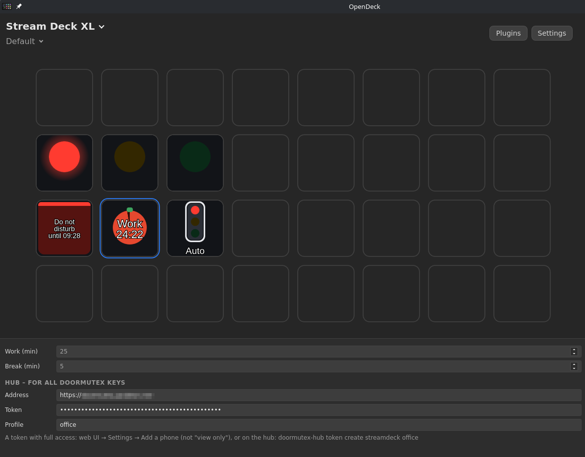

# Stream Deck plugin

Keys that show the light live and switch it – in [OpenDeck](https://github.com/nekename/OpenDeck) on Linux and in Elgato's Stream Deck app on Windows and macOS. One plugin for all three: it speaks the Stream Deck SDK's WebSocket protocol and is a native Go binary, so no Node.js is needed (OpenDeck's Flatpak has none).

<p></p>

## Keys

| Key | Shows | Press |
|---|---|---|
| **Lamp** (one per colour: red, yellow, green or off) | the lamp lit when the light shows it, dark otherwise – blinking phases blink along; a ring and "until 14:30" on the lamp you set by hand | sets that status for the key's duration; pressing the set lamp again returns to automatic |
| **Automatic** | a small traffic light with the current pattern; a ring while the light runs automatically | clears the override |
| **Status** | the status in words and until when, on the lamp's colour | opens the web UI |
| **Pomodoro** | a tomato; while one runs, the time left in the work or break block as a shrinking slice | starts a pomodoro (work/break from the key's settings, default 25/5), or stops the running one |

A key that can't reach the hub says so ("Hub offline"); before the hub is set up it says "Set up hub". Texts follow the Stream Deck software's language (English, German).

## Install

1. Download `doormutex-X.Y.Z.streamDeckPlugin` from the [latest release](https://github.com/padalton/doormutex/releases/latest).
2. Install it:
   - **OpenDeck:** *Plugins* → *Install from file*.
   - **Elgato app:** double-click the file.
3. Drag the doormutex actions onto keys. In the settings below the keys (the *property inspector*):
   - each **Lamp** key: the colour and *for how long* (15 min … 2 h, until the current event ends, until the end of the work day, until the next automatic change, until switched back);
   - each **Pomodoro** key: work and break minutes;
   - once, for all doormutex keys, the **hub**: address (`https://…` or `http://hub:8080`), token and profile.

The token needs full access: in the web UI *Settings → Add a phone* (not "view only"), or on the hub `doormutex-hub token create streamdeck office`. The Stream Deck software keeps it in its plugin settings; the plugin never logs it.

Tested on Linux with OpenDeck and a Stream Deck XL. The Windows and macOS builds are in the package but not tested yet – reports welcome.

## Build

```bash
streamdeck/build.sh                 # version "dev"
VERSION=0.2.0 streamdeck/build.sh
```

Needs Go and python3. It cross-compiles the binary for Linux (amd64, arm64), macOS (amd64, arm64) and Windows (amd64), draws the static pictures with the same code as the live keys, and writes

- `build/streamdeck/org.doormutex.trafficlight.sdPlugin/` – the bundle
- `build/doormutex-VERSION.streamDeckPlugin` – the installable zip

A release tag builds it through GoReleaser, CI on every pull request (*Stream Deck · package*).

### Try it in OpenDeck (Flatpak)

```bash
p=~/.var/app/me.amankhanna.opendeck/config/opendeck/plugins
rm -rf "$p/org.doormutex.trafficlight.sdPlugin"
cp -R build/streamdeck/org.doormutex.trafficlight.sdPlugin "$p/"
flatpak kill me.amankhanna.opendeck; flatpak run me.amankhanna.opendeck &
tail -f ~/.var/app/me.amankhanna.opendeck/data/opendeck/logs/plugins/org.doormutex.trafficlight.sdPlugin.log
```

## Code

| Where | What |
|---|---|
| [`org.doormutex.trafficlight.sdPlugin/`](org.doormutex.trafficlight.sdPlugin/) | manifest, German names (`de.json`), property inspector (`pi/`, plain HTML/JS) |
| [`companion/cmd/doormutex-streamdeck`](../companion/cmd/doormutex-streamdeck/) | the binary |
| [`companion/internal/streamdeck`](../companion/internal/streamdeck/) | protocol, keys, drawing (pure Go, 144 × 144 px) and tests with a fake Stream Deck and a fake hub |
| [`companion/internal/hubclient`](../companion/internal/hubclient/) | the hub API and event stream, shared with the companion |

It lives in the companion's Go module to reuse the hub client. It follows the hub's event stream (SSE) and only redraws a key when its picture or title changes; blinking phases tick every 250 ms.
